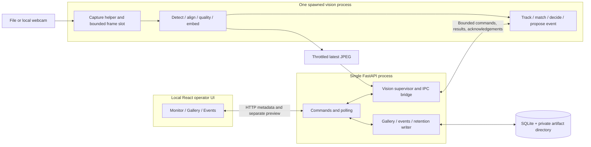
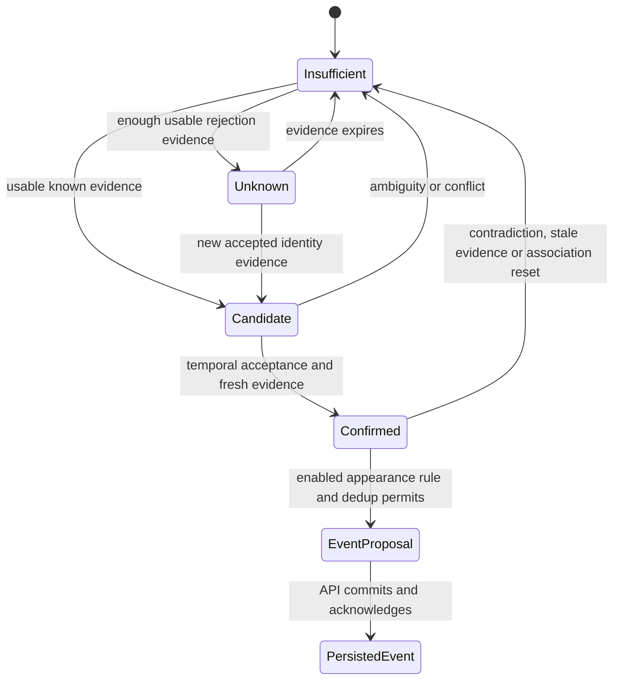
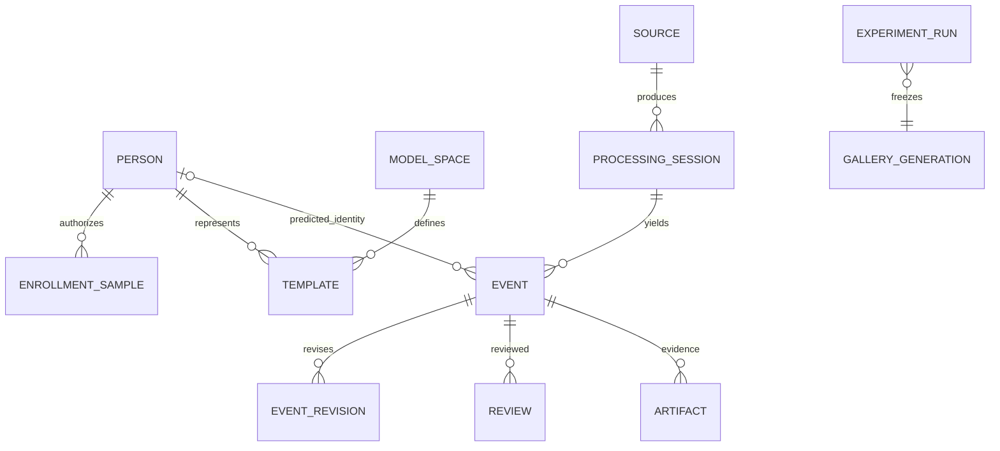

# odin: architecture, scope, and delivery plan

Status: architecture with user-accepted planning defaults, updated 19 October 2026. The original documentation task was completed at `92a1354`; the user then authorized model/environment preparation, explicitly stopping before recorded-video implementation. Real-model CUDA checks and a numerically verified FaceNet ONNX export now support a shared inference environment; see [ENVIRONMENT.md](ENVIRONMENT.md) for the current setup and [MODEL_FEASIBILITY.md](MODEL_FEASIBILITY.md) for the original probe. This is not a working video recognition/alert application; historical scaffold inspection below remains dated evidence.

Project name: **odin**. Course project category: Face Recognition and Surveillance Alerting. Python package: `face_surveillance`. The user explicitly chose to retain odin as the project's own name; no repository/package rename is proposed.

The authoritative course definition supplied by the user is: “Develop a real-time video pipeline that detects faces, handles masks/occlusion, matches faces against an authorized watchlist, tracks recognized subjects across frames, and generates alerts with confidence scores. The system should compare at least two recognition approaches and evaluate robustness under pose, illumination, distance, and partial occlusion. Include a simple operator interface and privacy-aware handling of stored face data.” Scope decisions below operationalize this definition; they do not add operational-security certification or an obligation to train models.

## 1. Executive recommendation

Build a controlled, local research prototype using pretrained face detectors and encoders. Deliver the complete course workflow early: authorized enrollment → recorded and live video → detection/alignment → two recognition approaches → face tracking → calibrated identity decisions → reviewable appearance alerts → simple operator interface. Then investigate whether observation quality and temporal aggregation improve alert reliability. Training a recognition network is outside scope.

The user confirmed **10 weeks, three people, unknown weekly availability**, a research prototype rather than operational deployment, and the requirement to compare at least two recognition approaches. The user's priority is an acceptable working project before extra features. The longer-term ambition is central inference over several camera feeds: recordings first, one local webcam, then two laptop webcams with one laptop doing inference, then additional/IP-camera feeds if time permits. Multiple feeds are a gated extension; they must not delay the one-camera course-complete release.

The user accepted the proposed application defaults: uploaded multi-sample enrollment, explicitly enabled appearance alerts, on-screen events with video evidence, configurable seven-day event retention, study recordings retained through grading/review, and one local operator. For planning, participant permission/data access are assumed available; exact recording/deletion dates, submission date and weekly availability are not prerequisites. Multi-camera operation and ensemble research have **equal optional priority**: either may start first or both may proceed alongside one another once their technical prerequisites and protected core/evaluation capacity permit. Neither extension depends on the other.

Keep Python, FastAPI, React/TypeScript/Vite, uv and the existing tested CUDA environment. Start with a headless replay program. For the integrated application, use one API process and one spawned vision process in a single package/repository, SQLite, a small NumPy gallery, and bounded local IPC. No task broker, vector database, distributed workers, or containers are required for the first release.

Use an InsightFace SCRFD detector and ArcFace-family encoder as approach A. Compare against the pinned FaceNet-family InceptionResnetV1 encoder as approach B, now exported and numerically verified for ONNX Runtime CUDA in the same environment. `facenet-pytorch` stays in an export-only source overlay, not normal runtime dependencies; exporter tools occupy a separate locked group. Both approaches must be evaluated; they need not run simultaneously during live monitoring. The main research experiment holds the encoder fixed while comparing single-frame, unweighted temporal, and quality-aware temporal decisions. Conversion does not clear source weight usage restrictions or establish recognition accuracy.

“Finished” means all course requirements have demonstrable evidence, an independently held-out evaluation exists, performance limits are measured, and failures/abstentions are visible. A positive research result is a hypothesis, not a graduation gate. This is not an operational security system.

## 2. Evidence and current state

### Verified repository facts

Inspection used the actual working directory `/home/deniz/Documents/391/odin`. Initial working tree was clean, branch `main`, HEAD `44c8f1d` (`Set up CUDA vision backend and React frontend`); no later commits were present. No applicable repository `AGENTS.md` was found by the inspection.

| Area | Verified state | Implication |
|---|---|---|
| Specification | `Face_Recognition_Project_Specification.md`, version 1.0 proposed, 12 October 2026 | A design proposal, not implementation evidence |
| Backend | `backend/src/face_surveillance/api/main.py`: FastAPI app, static `/health`; empty vision initializer | No video, gallery, recognition, tracking, alerts, persistence, or authentication |
| Test | `tests/test_scaffold.py` checks `/health` and OpenAPI | Proves scaffold startup only |
| Frontend | Generated Vite counter/assets; React 19, TypeScript 6, Vite 8, Oxlint | No operator workflow |
| Storage areas | `configs/`, `experiments/`, `docs/`, `data/`, `models/`, `runs/` had `.gitkeep` only | No repository models, dataset, configs, experiments, or results |
| Packaging | Distribution `face-surveillance`; package `face_surveillance`; Hatchling src layout | Keep package name; project/repository name is odin; formal course category is Face Recognition and Surveillance Alerting |
| Locking | `uv.lock`, dedicated explicit cu130 index for torch/torchvision, CPU `onnxruntime` excluded | Preserve working resolution; GPU distribution supplies `onnxruntime` import |
| Python | `.python-version` and actual interpreter: 3.14.8; project requires 3.14.x | New model integrations must support this environment or be isolated |
| Installed metadata | torch 2.14.1+cu130; torchvision 0.29.1+cu130; onnxruntime-gpu 1.31.0; InsightFace 2.1; FastAPI 0.143.0; httpx2 2.13.1 | These reported versions were confirmed locally; no assertion that they are latest |
| Imports | Application imports FastAPI; test imports FastAPI TestClient; GPU script imports torch, torchvision, ONNX, ORT, NumPy | Installed vision dependencies are not yet integrated into the application |

Existing validation rerun on 16 October 2026:

- `.venv/bin/ruff check backend tests scripts`: passed.
- `timeout 30s .venv/bin/pytest -q`: one test passed in 0.29 seconds outside sandbox. The initial sandbox TestClient run hung and was interrupted; this was not an application change.
- `npm run lint` and `npm run build` in `frontend/`: passed, production build with Vite 8.3.4.
- `.venv/bin/python scripts/check_gpu.py`: passed outside sandbox on NVIDIA GeForce RTX 4070 Laptop GPU, CUDA runtime 13.0. The initial sandbox run could not access CUDA.

The GPU script executes matrix multiplication in both runtimes, checks absence of the CPU-only ORT distribution, and disables CPU EP fallback for its ONNX MatMul session. It does **not** prove SCRFD/ArcFace compatibility, cuDNN convolution execution, video decoding, real-time performance, or recognition correctness. No weights were downloaded and no face model was instantiated during this review; InsightFace constructors can download missing model packs.

`httpx2` is not a typo to fix. Installed distribution metadata links to Pydantic's project, the lockfile records its PyPI hashes, and installed `starlette/testclient.py` prefers `import httpx2 as httpx`, falling back to deprecated `httpx`. The scaffold test passes with `httpx2`; ordinary `httpx` is absent. Retain it in the dev group. Upstream describes HTTPX2 as the Pydantic-maintained continuation of HTTPX. [HTTPX2 upstream](https://github.com/pydantic/httpx2)

### Historical information versus confirmed decisions

The earlier setup report described a CUDA-ready scaffold; current checks support that narrow claim. Its “next step” was a suggestion, not an implemented pipeline. The old specification reports 12 weeks and assumes 3–4 people: **superseded by the user's current 10 weeks and three people**. Its participant counts, GPU memory assumptions, performance numbers, and extensive required-release features remain proposals rather than available resources or measured results.

### Comparison with the existing specification

Preserve the specification unchanged as the original proposal and course mapping. After user approval, this architecture should own the current scope, acceptance gates, interfaces, and decision log; the original should be labeled historical in a later documentation task. Until approval, differences below are proposed changes, except the user-confirmed deadline/team and course definition. Do not maintain two competing normative requirement lists.

| Existing proposal | Assessment and proposed resolution |
|---|---|
| Pretrained encoders; quality/temporal evidence; unknown rejection; watchlist-only alerts | Agree; this is the main contribution and workflow |
| Two recognizers, robustness and simple interface | Confirmed course obligations; retain in first course-complete version |
| 12-week calendar; 3–4-person planning | Outdated: 10 weeks, three people, weekly capacity unknown |
| Full authenticated admin/operator system and encrypted payloads | Too much early product work for a local study. Use one local operator, local access controls and encrypted study storage; defer accounts/RBAC and application-level encryption unless deployment/rubric requires them |
| Webcam and replay required immediately | Stage replay first for reproducibility; webcam must exist before course-complete gate |
| CPU fallback a required release feature | Probe CPU correctness for reproducibility; GPU is the live target. No automatic fallback or equal CPU performance promise |
| ArcFace and `facenet-pytorch` ready to integrate | Not yet true: no weights; second package declares incompatible torch/NumPy ranges. Resolve at M1 without replacing working stack |
| WebSockets, MLflow, Docker Compose, encrypted database payloads | Options, not prerequisites; polling, local manifests, native execution and protected local storage suffice initially |
| Mandatory 20 enrolled + 12 unknown people, 2–4 hours; broad experiment matrix | Recruitment/effort unverified. Treat as aspirational dataset expansion; use a small feasibility dataset first, report independent exposure, and bound claims |
| 15 FPS, 250 ms and fixed temporal/cooldown starting values | Unmeasured proposals. Establish/freeze a benchmark profile and policy using validation; do not inherit numbers as acceptance thresholds |
| Multi-camera extension coupled to cross-camera evidence | Separate: central independent streams is the requested extension; cross-camera track association remains excluded |
| Full robust release before optional extension | Agree; protect course coverage and evaluation before scaling |

Missing decisions now made explicit: model/checkpoint compatibility and licensing gate, time domains, queue policies, durable event acknowledgement, gallery-update barriers, decision revisions, calibration denominators, two-model isolation, and source-specific scaling limits.

## 3. Purpose, operating envelope, and scope

### Purpose and users

The users are three student researchers and a local demonstrator/operator. odin studies authorized watchlist identification in controlled video. An enrolled identity is a participant with approved reference samples; only an explicitly enabled watchlist policy creates appearance alerts. Unknown people are not assumed threatening. There are no automatic interventions or external notifications.

Research question: **At a comparable false-identification/false-alert operating constraint, do time-spaced, quality-aware track observations reduce wrong/duplicate alerts and improve correct encounter recognition compared with single-frame and unweighted temporal baselines, without unacceptable delay or loss of coverage?**

Default controlled conditions: consenting participants, a fixed visible-light camera, a small gallery, several faces possible, one active stream for the core, the known Linux/GPU laptop, and local browser access. Capture face pixel size, lighting and pose rather than claiming a universal distance in meters. Physical masks, partial occlusion, pose, distance and illumination are evaluation conditions; robust handling includes abstention and failure reporting. No mask classifier or recovery of hidden facial detail is required.

Expected failures include missed tiny/fully hidden faces, motion blur, extreme pose/backlight, lookalikes, track switches, bad enrollment, new camera domains, spoofed faces and source/GPU loss. No face detected does not prove no person is present. The prototype must expose degraded/unavailable states and never force an identity to produce an impressive demo.

### Scope tiers

“Baseline” is an intermediate vertical slice, not an acceptable final course submission. “Main/core” is the first course-complete release. “Research target” follows core and is the preferred improvement if capacity permits. Stretch begins only after core acceptance and protected final-evaluation time.

| Capability | Tier | Reason and bound |
|---|---|---|
| Recorded video, reproducible detector/alignment/embedding timings | Baseline | Earliest inspectable pipeline; no UI dependency |
| Authorized multi-sample gallery; known/unknown/insufficient states | Baseline → core | Required watchlist matching; calibrate open-set behavior |
| Two pretrained recognition approaches | Core | Explicit course requirement; same protocol, separate model spaces; only one needed in live mode at a time |
| One local webcam and recorded replay | Core | Real-time course requirement plus repeatable experiments |
| Multiple visible faces in that stream; track lifecycle | Core | “Tracks recognized subjects across frames”; no fixed one-face shortcut |
| Conservative time-spaced voting and basic quality rejection | Core | Reliable identity persistence/alerts without elaborate method development |
| Enabled-person appearance events, deduplication, history, review, metadata export | Core | Demonstrates alerts and permits evaluation; on-screen delivery only |
| Event video clips around confirmed watchlist appearances | Chosen application target, M4 | User-selected evidence behavior beyond the literal course minimum; bounded buffering/recording, no permanent recording of every frame |
| Confidence evidence with calibrated interpretation | Core | Raw similarity plus evidence state; probability only after validation calibration |
| Simple operator UI: monitor, enrollment/gallery, events, health | Core | Required interface; compact screens, no dashboard polish |
| Privacy controls, retention, deletion, provenance | Core | Required handling of stored biometric data |
| Pose, illumination, distance, physical mask/partial occlusion evaluation; unknown people | Core | Explicit course robustness requirement |
| Quality-weighted temporal aggregation and ablations | Research target | Main investigation; cannot postpone basic course completion |
| Two network laptop feeds, central inference | First stretch | User's scaling direction; independent source state and fair GPU scheduling |
| Three+ streams or real RTSP/IP camera | Later stretch | Only after two-feed resource/latency results; never promise arbitrary scaling |
| Additional tracker/gallery optimizations | Stretch | Add only to address measured failure or bottleneck |
| Additional recognition methods and calibrated score fusion | Stretch | Compare individual methods first; investigate fusion only with protected core/evaluation time; improvement is not presumed |
| Unknown-person persistence alerts, zones, audio/email/SMS | Deferred/excluded from core | Different alert semantics/delivery; no course need |
| Multi-user accounts/RBAC; remote operator interface | Deferred | Core trusts one local OS operator; network camera ingestion does not require remote UI |
| Liveness/anti-spoofing | Excluded | Separate data and evaluation task; print/replay attacks may succeed; no access control use |
| Cross-camera re-identification/trajectory fusion | Excluded | Independent camera recognition is not identity association across cameras |
| Large galleries/vector DB; cloud/distributed inference; mobile clients | Excluded | No core workload justifies infrastructure |
| Encoder training/fine-tuning; demographic/behavior inference | Excluded | Pretrained research focus; not needed for stated requirements |

### Accepted defaults and remaining technical checks

No further planning answers about dates, weekly effort or participant permission are required. The user accepted the defaults and asked that data access be treated as available. The remaining items below are implementation/evaluation checks, not another scope questionnaire:

1. **Course interpretation is a working assumption:** ArcFace-family versus FaceNet-family is a defensible two-method comparison under the supplied wording, not an assessor-confirmed guarantee. Both are deep embedding methods. If classical versus deep methods are required, use LBPH as an additional comparator or approved replacement; there is no automatic need to implement three recognizers. Display labeled similarity and temporal support as confidence evidence, never an uncalibrated percentage. The supplied definition does not explicitly require probabilities or both encoders running live. Do not substitute two temporal variants for the two encoders.
2. **Data:** approximately 8–10 volunteers are available; assume permission for the required controlled recordings. Volunteer recordings form the primary study, curated public media a separately reported supplementary test. Independent sessions/annotations still have to be collected; availability is not completed evaluation evidence. Preserve privacy/deletion features required by the course without adding a participant-approval workflow. Model and third-party dataset usage terms remain asset-specific technical checks.
3. **Deployment/storage:** accepted default is one local OS-controlled operator with restricted/encrypted study storage. Verify the storage mechanism during implementation; no further planning confirmation needed. Shared/untrusted hosting or remote UI is outside the accepted core.
4. **Capacity:** use the confirmed 10-week/three-person envelope and dependency-ordered gates without requiring an exact date or weekly-hour estimate. Illustrative week ranges are not delivery promises.
5. **Extensions:** multi-camera and ensemble research are equal-priority, independent options. Protect required workflows/evaluation, then choose either or pursue both according to available capacity. Camera/OS/network details are implementation checks when network work begins; remote operator access is not implied.

## 4. Architecture and process model

### Alternatives and selection

| Approach | Advantages | Costs | Decision |
|---|---|---|---|
| One process with API, capture/inference threads | Fast initial setup; direct state sharing | Native capture stalls/GPU faults share API lifetime; synchronization and restart awkward | Headless pipeline first; threaded web monolith not the integrated default |
| Modular monolith, API + one local vision process | Clear GPU ownership; responsive API; process can be terminated on capture hang; reuse pipeline in evaluation | IPC, gallery synchronization and acknowledgement protocol required | Recommended integrated core; one deployment and codebase |
| Independent vision service + broker/database services | Separate scaling/hosts | Operational and recovery complexity beyond course needs | Revisit only for measured multi-worker/remote-compute requirements |

One Uvicorn API worker owns SQLite writes and starts one vision child in application lifespan. Use explicit multiprocessing `spawn`; load CUDA only in that child, never inherit an initialized GPU context. API owns child supervision and shuts it down; no separate service orchestrator. FastAPI documents lifespan for resource setup/teardown; Python documents process start methods and IPC. [FastAPI lifespan](https://fastapi.tiangolo.com/advanced/events/), [Python 3.14 multiprocessing](https://docs.python.org/3.14/library/multiprocessing.html#contexts-and-start-methods)

The CLI evaluation mode runs the same pipeline directly in its own process and writes run artifacts without starting the API. Do not run benchmark and live inference together on the same GPU unless explicitly measuring contention. Loading approach B for an experiment is sequential by default; live model selection restarts the processing session.



### Monitoring flow and ownership

| Frequency | Operation and contract |
|---|---|
| Per session | Resolve immutable config/model/gallery versions, load/warm models, validate compatibility, record source clock/profile, initialize fresh track namespace |
| Per decoded frame | Capture `FramePacket`, enforce sampling/backpressure, assign sequence, resize detector input with inverse coordinate mapping |
| Per selected processing frame | Detect all faces and five-point landmarks; spatially associate detections using elapsed source time; publish timestamped preview metadata |
| Per face observation | Validate landmarks/crop, compute quality, optionally embed based on per-track cadence/budget; normalize finite nonzero vector; search compatible gallery |
| Per track update | Update bounded evidence, candidate/unknown/confirmed/insufficient decision, freshness and contradiction state; possibly propose event |
| Per event | Validate policy and current gallery generation, deduplicate, persist provenance transactionally, acknowledge, then publish durable alert |

Recommended sequence: detector → association → model-specific alignment/quality → selective embedding → gallery search → temporal decision → alert rule. Tracking can use a detection too weak for recognition. No embedding is generated from a motion-predicted box alone. No face means no new observation; missing tracks may still be visible as stale predictions.

Core contracts (conceptual types, not implemented):

```text
FramePacket(source_id, session_id, seq, media_time_ns?, received_monotonic_ns,
            received_utc, bgr_image, timestamp_basis)
Detection(bbox_xyxy_in_original_pixels, five_landmarks, detector_score, detector_version)
Observation(observation_id, track_id, association_epoch, frame_ref, quality_features,
            quality_reasons, embedding_space_id?, normalized_embedding?)
MatchResult(best_person?, best_similarity?, second_distinct_person_similarity?, margin?,
            gallery_generation, embedding_space_id)
Decision(track_ref, revision, state, person_id?, reason, evidence_count, evidence_span,
         latest_evidence_time, score_summary, policy_version, calibration_version)
EventProposal(idempotency_key, decision_snapshot, encounter_key, source/session/config_refs)
```

`track_id` is unique only with `source_id + session_id`; it never equals `person_id`. `association_epoch` changes whenever association is reset. Pixel coordinates, image channel order, time units, optional fields and embedding space are explicit at boundaries. Preview boxes refer to the same frame sequence as the image; do not overlay newer detections on an older frame.

### Capture, time, sampling, and bounded work

- Recorded evaluation uses presentation/media time for tracking and evidence windows, and monotonic wall time for performance. Core supports validated constant-frame-rate fixtures; if backend timestamps are absent, record frame-index/FPS as a derived basis. Reject or mark invalid non-monotonic time; do not silently treat VFR media as CFR. Exact VFR/RTSP presentation timestamps justify PyAV later.
- Webcam time is host receipt time, not claimed sensor exposure time. Store UTC for human provenance and monotonic time for intervals; clock adjustment cannot alter cooldowns. Network extension reports receiver-side latency separately from true camera-to-display latency unless clocks are synchronized and sender timestamps validated.
- Offline mode processes every frame in the declared sampling manifest, applies backpressure and never drops selected frames. “Exhaustive” means every selected frame, with selection cadence recorded. Replay-as-live uses the live drop policy and is labeled accordingly.
- Live capture runs in a helper thread inside the vision process with a latest-frame slot of capacity one. When inference falls behind, replace the waiting frame, increment drops, and preserve sequence/time gaps. This does not remove hidden driver/decoder buffering: probe backend buffering and measure actual age.
- Detector runs at the configured processing cadence; embedding is time-spaced per track with an observation budget, not blindly per detected face per input frame. Core uses a bounded evidence window and observation cap. Values are chosen during validation, not invented as accuracy thresholds.
- Initial engineering bounds: command queue 16 messages, reliable-result queue 64 messages, latest preview slot one encoded JPEG, one enrollment job at a time, finite upload bytes/pixels, configured maximum active tracks and embedding observations. These are resource bounds, not validated throughput claims; record changes in config. A full command queue returns `429` or `503` without enqueueing hidden work.
- Reliable decisions/event proposals cannot be silently overwritten. If result persistence cannot drain within a configured timeout, stop/pause processing and expose `storage_unavailable`/`backpressure`; resume with fresh track evidence. Preview and health snapshots can coalesce. Do not hide overload as “unknown.”

### Models and background execution

Vision child owns one detector and one active encoder session, shared across faces and (later) streams, with a single inference scheduler. Start at batch size one; batch only if measured latency/memory benefit warrants it. Instantiate only necessary detector/recognizer adapters, not InsightFace's liveness, attributes, body ReID or GUI/server facilities. Pin detector input size explicitly so library auto-sizing changes cannot silently change experiments.

Startup checks local checkpoint existence and SHA-256, preprocessing signature, output dimensions, requested CUDA device/provider, gallery compatibility and a real-model warmup. Record actual provider assignment and per-stage profiles; `get_available_providers()` alone is insufficient. Required-GPU mode fails visibly if CUDA is unavailable. CPU mode is an explicit separate profile/run, not a silent change after GPU failure. Model load/warmup has an observable `starting/ready/failed` state.

API requests enqueue bounded commands and return job IDs; inference/enrollment extraction never executes inside HTTP handlers or FastAPI response background tasks. Enrollment jobs are served between frame operations with fairness/time limits; if interruption would compromise a live run, require a visible session pause. No second model-loaded web worker. IPC is local, typed envelopes over standard multiprocessing queues; never accept network pickle payloads. API's IPC/DB bridge runs outside the async request loop. File previews are throttled independently of inference.

### Lifecycle, failure, and reconfiguration

| Trigger | Required behavior |
|---|---|
| EOF | Session completed; flush results; stop tracking; UI says replay ended, never reconnect loops |
| Webcam/source loss | `disconnected`, stale preview timestamp, no new alerts; bounded retry/backoff; new session and evidence after reconnection |
| Native read hang | Supervisor detects expired heartbeat/frame deadline; terminate/recreate child after bounded shutdown; API remains responsive |
| GPU OOM/provider failure | Session failed; drop pending identity evidence, release child; report fault; operator may choose explicit lower-load/CPU profile; no fabricated CPU-equivalent results |
| DB/disk unavailable | Events not shown as saved; bounded retry or processing pause; surface data-loss boundary; do not grow an unbounded memory spool |
| Restart | New session/track IDs; gallery/events survive; prior sessions marked interrupted; no resuming stale evidence |
| Model/preprocess/threshold/tracking config change | Validate first, stop/start session, record config hash; no mixed-policy evidence window |
| Gallery change | API transaction increments generation; child atomically swaps snapshot and clears affected evidence; API rejects old-generation event proposals |
| Delete/deactivate | Immediately block new matching/alert eligibility at API; completion only after child barrier acknowledges, or child stops and memory is discarded |
| Shutdown | Stop accepting commands; stop capture; bounded flush/ack; mark session end; close model/process/DB resources; force terminate only after deadline |

Deduplication receipts persist across restart within the configured cooldown; reconstruct age using UTC with explicit handling of clock discontinuity. Restart does not itself authorize a duplicate event. An abrupt child failure can lose uncommitted proposals: at-least-once retry with idempotent DB insert covers a living worker's retries, not crash-proof distributed delivery. Report interrupted exposure and do not claim lossless monitoring.

### Future central multi-feed extension

Recommended first network route: laptop camera publisher → RTSP media gateway on the inference laptop → odin RTSP source adapter. MediaMTX plus an existing FFmpeg/OBS publisher is a credible optional integration, avoiding a custom streaming protocol. Its documentation covers webcam/software publishing, RTSP and per-path authentication; its source is MIT licensed. This review neither installs it nor assumes sender encoders/camera drivers work. [MediaMTX publishing](https://mediamtx.org/docs/features/publish), [authentication](https://mediamtx.org/docs/features/authentication), [license](https://github.com/bluenviron/mediamtx/blob/main/LICENSE)

Alternative browser WebRTC capture reduces sender setup but introduces signaling, browser permissions and a media server stack; defer. A custom HTTP/MJPEG sender is easy to prototype but adds buffering/transport behavior that contributes little to the course; use only if the RTSP probe fails for a concrete reason.

At two feeds: one decoder per source with bounded slots, round-robin or age-aware fair scheduling through the shared detector/encoder, separate tracks/evidence/encounters per source, global resource admission limit, and per-source metrics. If one decoder hangs and isolation is necessary, move decoding to small processes before introducing more GPU workers. A person seen on two cameras may create two source-scoped events; that is correct under this scope. Protect core tests and compare one-versus-two-feed latency/coverage; permit a third only if both existing feeds stay within the frozen profile. No linear scaling claim.

Only camera ingestion is networked: keep the operator API on loopback. Restrict gateway publishing/reading to named paths, credentials and an isolated trusted LAN/firewall. Authentication is not encryption: untrusted networks need encrypted transport or a VPN before face video is sent. No internet camera exposure. Camera credentials live outside exported configs/logs. Real IP camera availability and codecs are an extension feasibility gate.

## 5. Recognition, abstention, and alerts

### State semantics

| State | Meaning | Alert eligibility |
|---|---|---|
| No face detected | Frame-level detector result; not a statement about identity or absence of people | None |
| Poor-quality observation | A face exists, but size/blur/exposure/landmark/crop checks fail; observation has reasons | This observation cannot support recognition |
| Insufficient evidence | Track has too few fresh usable samples, ambiguity, contradiction, stale evidence, incompatible gallery or no gallery | None; show reason, not “unknown” |
| Candidate(person) | A known identity is plausible but temporal acceptance is incomplete | None |
| Confirmed(person) | Fresh usable evidence meets calibrated acceptance and temporal rules | Only with an active enabled watchlist rule |
| Unknown | Sufficient fresh usable evidence supports rejection of all enrolled identities under the calibrated open-set policy | None by default; not a threat label |

Poor quality is an observation property, not necessarily the current track decision: a track can have prior confirmation plus a currently poor observation. Show evidence freshness; once expired, demote to insufficient. Track lifecycle (`tentative/active/missing/expired`) and source lifecycle are separate dimensions. “Unavailable” is a system/source error, not a recognition class.



The diagram's event branch is an action, not a replacement for the track's recognition state. Unknown can become known as new evidence arrives. Confirmed A cannot silently become confirmed B: reset the evidence/association epoch, collect new evidence, and confirm B independently. A long stale interval ends the prior encounter. New observations never retroactively alter original event scores.

### Tracking and evidence

Use Kalman prediction with elapsed time and gated Hungarian assignment based on overlap/center motion, using SciPy for assignment. Keep recognition identity out of the initial association cost so tracker and recognizer can be evaluated separately. Multiple detections are assigned one-to-one; unmatched detections start tentative tracks, unmatched tracks become missing and expire by time. Prediction alone carries no new identity evidence. Large motion, crossing ambiguities or a runner-up association too close to the best reset or split tracks rather than copying identity history.

Association confidence is imperfect: add conservative contradiction checks on accepted embedding evidence, test crossings/occlusions, and report residual identity switches. Do not assume a box tracker prevents identity contamination. Expired tracks discard embeddings. Reappearing faces get new track IDs; alert policy can suppress fragments without claiming they are the same physical trajectory.

Quality begins with interpretable features: face pixel dimensions, sharpness normalized to a declared crop scale, clipped/dark exposure fraction, landmark fit/geometry, and rough pose proxies. Detector scores and pose estimates are not calibrated image-quality probabilities; mask detection is optional. Gate unusable crops before encoding. For quality weighting, choose a bounded nonnegative mapping on validation; cap weights and observation count, and retain feature values/reasons.

Normalize each embedding to unit L2 norm; invalid/near-zero outputs are errors. Baseline gallery is one normalized mean of accepted normalized enrollment embeddings per person. Search all identity centroids with a NumPy dot product. Return best score and margin to the second **distinct** identity. An empty gallery yields insufficient; with one identity the margin is unavailable and uses a separately calibrated acceptance rule, not an infinite margin. Multi-template scoring is optional and needs recalibration because it changes impostor extremes.

Core temporal baseline: time-spaced accepted observations vote for their accepted identity in a bounded rolling window; require validation-selected count, span and vote agreement. Votes failing the single-observation gate do not become positive identity evidence. Include quality failures/rejections in coverage reporting. Research temporal baseline: normalized unweighted mean embedding; proposed improvement: `normalize(sum(w_i * e_i))` with bounded quality weights. A zero sum or no usable samples gives insufficient. Match aggregate against the same gallery and apply separate calibrated track policy; agreeing adjacent frames are not independent likelihoods.

Strong conflicting identities, contradictory embedding clusters or uncertain association invalidate the window; weak observations cannot overwhelm a strong earlier observation by sheer frame count. Use capped sampling and a finite time window; do not multiply per-frame confidence probabilities. Insufficient near-threshold or tied evidence remains ambiguous. Unknown requires adequate usable evidence and the versioned rejection rule; “failed acceptance on one blurry frame” is not that rule.

### Calibration and confidence

No numeric similarity/quality/margin thresholds are chosen here. M3 obtains known genuine, wrong-known and unknown score distributions from calibration sessions, compares candidate policies and selects operating points with documented exposure and uncertainty. Tune rejection, quality, margins, sampling/window parameters and alert cooldown on validation, then freeze before test. Use separate policy versions for models, preprocessing, gallery/template policy and gallery-size regime. A significant gallery update marks calibration applicability for review; model-space changes block incompatible templates entirely.

Display detector confidence, cosine similarity, observation count/span, decision state and reason as separate fields. A cosine score is not a probability. To satisfy a literal probability-style confidence requirement, fit a simple track-decision correctness calibrator on independent development/calibration encounters and validate reliability/Brier score on held-out sessions. Calibration includes unknown and wrong-known outcomes; avoid an impressive percentage trained only on easy accepted known samples. If calibration is unsupported/out of domain, show “uncalibrated similarity,” not a percentage. Instructor confirmation of score semantics is an early acceptance check.

### Appearance events and deduplication

Only `enrolled_person_appearance` is core. Conditions: enabled watchlist person, confirmed decision, fresh evidence, current model/config/gallery, active source, and permission to rearm. Enrollment alone does not turn on alerts. Unknown persistence, entry/exit, loitering and suspicious behavior are not inferred.

An encounter is source-local continuous presence with a validation-defined missing gap. First eligible confirmation creates one event; continued presence, new preview frames and temporary poor quality do not repeatedly alert. A source/person cooldown also suppresses short tracker fragmentation. Rearm only after the observed absence interval and cooldown permit it; cooldown alone cannot repeatedly alert on an uninterrupted track. Two simultaneous tracks claiming the same identity are a conflict requiring review, not automatic track merging. Cross-track suppression can hide genuine reappearances; measure suppressed/missed events.

Event proposal includes stable idempotency key (session, encounter, person, rule), decision revision and gallery generation. API transaction checks current eligibility/generation, source/person dedup state and uniqueness, saves event plus dedup receipt, then acknowledges. Duplicate retry returns the existing event. UI may show a pending proposal, clearly distinct from a durable alert.

An already-created event retains the original prediction and provenance. Later contradiction appends a system invalidation/revision; operator acknowledgement and `correct/incorrect/uncertain` review are separate records. Do not relabel history as if the original system was right. Deletion is an explicit privacy exception: remove identity/biometric linkage as specified below and retain only permitted non-identifying aggregate counts.

### Selected event-video behavior

Keep authorized watchlist enrollment data across processing sessions until the person is deleted or the agreed study authorization expires. This is distinct from temporary tracks and event footage. Use a bounded rolling video buffer; on a confirmed eligible watchlist appearance, retain the preceding context and record the encounter. Keep brief low-quality/occluded intervals inside that clip rather than cutting out individual uncertain frames. Stop after the absence/post-roll policy permits, or segment a long encounter without generating duplicate appearance alerts. Other buffered footage expires.

Proposed engineering starting settings: five seconds of pre-roll, five seconds of post-roll/absence grace, and at most 60 seconds per file segment. These are adjustable storage/context defaults, not validated recognition thresholds; confirm frame-buffer memory and encoding cost in the benchmark. Bound buffer bytes as well as duration, enforce a configured disk quota, and avoid duplicating a full-frame clip for every simultaneously visible watchlist person: events can reference a shared artifact. Share deletion/retention ownership explicitly; removing an artifact marks its other event links as evidence unavailable.

Capture/encoding/storage must not block inference or HTTP: a bounded recorder queue and encoder helper own staged files. Finalize files atomically, then mark the artifact ready. Persist the alert independently with `evidence_status=pending/ready/failed/expired`; recording failure does not fabricate a saved clip or hide a valid alert. On buffer/encoder overload, discard oldest pre-roll or stop recording with a visible incomplete-evidence reason, preserving recognition responsiveness. Record missing intervals. Crash recovery cleans staged partial files and marks interrupted evidence. Profile the actual capture/encode backend before adding a new media dependency.

Full-frame event clips may contain unenrolled bystanders and low-quality faces; the no-unknown-crop rule does not imply their absence from contextual video. For this controlled study, authorization must cover everyone recorded in retained clips. No persistent unknown templates or separately indexed unknown-face crops are created. A clip exists because of a system prediction, which can be wrong; review/invalidation and deletion remain available. Complete evaluation recordings are retained separately, including negative and missed-recognition intervals, so event-selected clips cannot bias reported performance.

## 6. Technology decision records

All recommendations are proposed, except preservation of the current scaffold/environment during this task. Each row includes a reason to revisit; “already installed” alone does not justify production dependency status.

“Two recognition approaches” is interpreted here as two distinct recognition methods/models; it is not an explicit requirement for one classical and one deep-learning method. ArcFace-family and FaceNet-family pipelines are a defensible comparison under that wording, but only the course assessor can settle an ambiguous rubric. Both use deep embeddings; report the exact architectures, checkpoints and training provenance rather than claiming completely different algorithm families. If the intended comparison is classical versus deep learning, use LBPH versus the primary deep encoder instead.

Distinguish the original FaceNet paper from available FaceNet-named implementations: original FaceNet uses triplet-loss training, whereas the Sandberg InceptionResnetV1 checkpoints ported by `facenet-pytorch` are documented as softmax-trained. Thus the proposed pretrained comparison cannot be described as a controlled ArcFace-loss-versus-triplet-loss experiment. ArcFace itself names an additive angular-margin training loss, not a unique network architecture. [Original FaceNet](https://arxiv.org/abs/1503.03832), [ArcFace](https://arxiv.org/abs/1801.07698), [checkpoint training provenance](https://github.com/davidsandberg/facenet#pre-trained-models)

| Decision | Recommendation and rationale | Alternatives, disadvantage, revisit condition |
|---|---|---|
| Detector / encoder A | SCRFD-10GF + ArcFace-family ResNet50 from `buffalo_l` as the initial research pair; freeze actual files/hashes, landmark and crop conventions | Smaller SCRFD/MBF reduces compute but changes accuracy. RetinaFace is credible but adds another integration. Benchmark before choosing smaller models; checkpoint availability/license is a gate |
| Model integration | Narrow InsightFace detector/recognizer adapters; retain preprocessing helpers and direct local model loading | Direct ORT removes wrapper behavior but owns decoding/NMS/alignment. PyTorch-native model requires port equivalence. Switch only for reproducibility/API limitations; do not adopt the upstream GUI/server as odin's architecture |
| Encoder B | FaceNet-family InceptionResnetV1 via the verified local ONNX export; mandatory independent comparison, same inference environment as A | Original package constraints conflict; retain its audited overlay only for export/reference. Conversion parity passed on11 numerical fixtures, not recognition evaluation. Separate old-dependency environments remain a fallback, not the selected setup. Source checkpoint terms still apply |
| Runtime | ORT CUDA for all three model inference sessions; PyTorch for GPU checks, export/reference research and current CUDA-library provisioning | A supported PyTorch-native stack is an alternative if needed. ONNX is not inherently faster; this choice resolves shared-runtime dependencies. Preserve current torch/CUDA versions; removal would need explicit library-provisioning checks |
| CUDA validation | Preserve cu130 index/lock and GPU-only ORT distribution exclusion; warm real models and inspect provider execution | Driver runtime, cuDNN and operator support can still fail. Explicit CPU profile, not silent fallback. Revisit only after a reproducible model/operator issue |
| Tracking | Gated Kalman/Hungarian face-box baseline | ByteTrack adds low-score association; DeepSORT-style appearance adds another model and circular evidence risk. Add ByteTrack comparison only if fragmentation harms alerts; validate on faces, not pedestrian claims |
| Video/images | OpenCV `VideoCapture`, BGR arrays, explicit model color/preprocessing adapters; JPEG low-rate preview | Backend timestamp/buffer behavior varies. PyAV/FFmpeg gives stronger media control at integration cost; add for demonstrated VFR/network timestamp or buffering need |
| API/frontend | Keep FastAPI/Pydantic and React/TypeScript/Vite | Alternatives offer no current benefit. Use generated OpenAPI types when contracts stabilize; no redesign of scaffold now |
| Persistence | SQLite + SQLAlchemy, local filesystem artifacts, one API writer, short transactions; schema migrations from first durable gallery | PostgreSQL adds server administration. Revisit for multiple writer processes/hosts or sustained write contention; SQLite file must not live on a shared network drive |
| Embeddings/search | Float32 versioned payloads in protected storage, NumPy contiguous snapshot and exact cosine search | A vector DB/FAISS is unnecessary for tens of identities; benchmark O(ND) when galleries materially grow. Indexing changes recall/calibration and deletion consistency |
| Execution/IPC | One spawned vision process, bounded local queues, no broker; CLI uses same pipeline | Thread-only easier but poorer failure boundary; Celery/Redis/remote RPC unnecessary. More decode processes only when measured blocking requires them |
| UI updates | Poll versioned status/events; separate throttled JPEG endpoint with matching sequence/metadata | SSE is a sensible later event push upgrade; WebSockets needed only for genuinely bidirectional low-latency control. Polling costs small latency/request overhead; tune cadence using UI responsiveness/worker load |
| Config/experiments | YAML validated by Pydantic, immutable resolved JSON snapshots, local JSONL/CSV/plots; Git-tracked experiment manifests | Hydra/MLflow/DVC add management cost. Add only for demonstrated run/data volume; never store biometric payloads in public trackers |
| Packaging/deploy | Keep uv.lock, npm lock, Python/Node pins; future reproducibility uses frozen installs and explicit model manifests; native Linux processes | Containers do not fix driver/checkpoint issues and complicate webcams. Optional tested container later for another machine; no Compose stack in core |
| Local protection | Single OS-controlled operator; loopback API, exact local origins, guarded mutation requests, encrypted study directory/volume, restrictive permissions | User accounts and application-layer payload encryption add key/session lifecycle. Required before shared/untrusted host or remote UI; not silently promised by SQLite |

### Current primary-source checks and licensing

Sources were consulted on 16 October 2026. Links to upstream main branches can change; M1 records exact source revisions, artifact hashes and license text for selected assets. Research eligibility is not blanket redistribution or deployment permission.

- InsightFace code is MIT; its supplied pretrained models/training-data-derived assets are restricted to non-commercial research, separately from code. Record detector **and** encoder checkpoint terms. Do not bundle weights in the repository or assume operational/commercial rights. [InsightFace licensing notice](https://github.com/deepinsight/insightface#license)
- The current model zoo lists `buffalo_l` with SCRFD-10GF and ResNet50@WebFace600K; direct local ONNX loading is supported. The current API may auto-download packs and choose detector sizes automatically; explicitly require local files and fixed input configuration. Download links existing does not prove the chosen bytes are available/compatible on this machine. [InsightFace model zoo](https://github.com/deepinsight/insightface/blob/master/python-package/docs/model_zoo.md)
- `facenet-pytorch` provides InceptionResnetV1 checkpoints derived from VGGFace2/CASIA-WebFace and MIT code. Its current setup requires NumPy `<2`, torch `<=2.3.0`, torchvision `<=0.18.0`, incompatible with odin's pins. The code license alone does not establish pretrained-weight/dataset usage rights: record checkpoint terms and upstream training-data restrictions before use; if unclear, choose a documented alternative or seek clarification. This is an outstanding **M1 gate**, not a claim of cleared licensing. [Implementation/checkpoints](https://github.com/timesler/facenet-pytorch), [dependency declarations](https://github.com/timesler/facenet-pytorch/blob/master/setup.py), [VGGFace2 source](https://www.robots.ox.ac.uk/~vgg/data/vgg_face2/)
- ORT's current CUDA documentation states CUDA 13 is the default GPU package family from 1.27; CUDA/cuDNN compatibility and preloading matter. Its displayed compatibility table reaches 1.30.x, so it does not independently certify this installed 1.31.0 build. The local MatMul test is evidence for the installed pair; real-model convolution warmup and provider profiling remain necessary. Runtime speed is a measurement, not a consequence of the ONNX format. [ORT CUDA EP](https://onnxruntime.ai/docs/execution-providers/CUDA-ExecutionProvider.html)
- ByteTrack's original implementation is MIT and associates lower-score detections; its published pedestrian results are not a face-tracking guarantee. [ByteTrack upstream](https://github.com/FoundationVision/ByteTrack)
- OpenCV documents backend-dependent capture properties; verify behavior against installed OpenCV 5 rather than assuming online 4.x examples certify it. SQLite is suitable for local embedded storage but has writer/concurrency limits. These facts support the decisions above, not performance guarantees. [OpenCV capture flags](https://docs.opencv.org/4.x/d4/d15/group__videoio__flags__base.html), [SQLite appropriate uses](https://www.sqlite.org/whentouse.html)

Maintain a model manifest per detector/encoder: upstream URL/revision, filename, hash, code license, weight license/usage limits, training-data provenance, input/output schema, color/layout/normalization, landmark template, runtime/providers and tested versions. Also inventory licenses of redistributed code/media tools and evaluation data. No model acquisition or dependency modification is authorized by this review task.

## 7. Enrollment, data model, retention, and interfaces

### Enrollment and compatibility lifecycle

Create a pseudonymous person with authorization reference and alerts disabled by default. Upload image samples for core; webcam enrollment is later convenience. Reject zero/multiple faces, invalid landmarks, unusable crops and duplicate file hashes with useful reasons. Several diverse usable samples are recommended; exact minimum/quality floors are validation-derived, not a hidden “5 photos guarantees recognition” assumption. Potential same-person enrollment under another ID is flagged by similarity for operator review; never automatically merge or overwrite.

Stage extraction without changing the active gallery. Activate accepted samples/templates transactionally only when the chosen model's requirements are met; failures leave the prior generation intact. Approach B can extract equivalent enrollment observations in its separate evaluation environment. Gallery activation for the selected live model requires compatible templates for its active people; show a missing-template error rather than silently omitting identities. Use immutable gallery generations for experiments.

Embedding space key comprises encoder checkpoint hash, preprocessing/alignment signature, output dimension and normalization convention. Equal dimension is insufficient. Changing space requires re-embedding authorized retained enrollment sources or re-enrollment, new gallery generation and recalibration. If enrollment source retention was declined, explain that automatic migration is impossible. No online self-enrollment or feedback-driven template updates.

### Persistent and transient entities

| Entity | Essential fields and relationships | Persistence boundary |
|---|---|---|
| Person | UUID, pseudonym, active/watchlist flags, authorization ref, created/deleted state | SQLite; authorization records private, never public exports |
| EnrollmentSample | Person FK, source digest, accepted/rejected status, quality/reason, optional private file ref | Accepted sample metadata; retain image only under study policy |
| ModelSpace / Template | Model/preprocess hashes, dimension, dtype, person/sample FKs, normalized payload, generation | Sensitive persistent template; independent payloads per model |
| GalleryGeneration | Generation ID, active person/template references, digest | Snapshot manifest; invalidated generations containing withdrawn participants removed/redacted |
| Source | UUID, kind, sanitized label, private locator/secret reference, requested profile | Config metadata; do not expose filesystem paths/credentials to viewer/export |
| ProcessingSession | Source FK, start/end UTC, media clock basis, mode, config/model/gallery refs, termination reason | SQLite summary; restart creates new session |
| Track | Session + local ID + association epoch, start/end, summary | Live kinematics/observations transient; persist only event-linked summary or authorized evaluation predictions |
| Decision | Revision, track ref, state/person?, raw scores, evidence count/span, reason, versions | Live decisions transient; event snapshot immutable, full trace only in private experiment artifacts |
| Event / EventRevision / Review | Event UUID, idempotency key, encounter/rule, decision snapshot, timestamps, invalidations, operator label | Durable history; original prediction separated from subsequent review |
| Artifact | Private relative path, media type/hash, owner refs, retention deadline, deletion state | Files outside served static root; DB metadata controls access |
| ExperimentRun | Input/partition manifest hashes, config, model/gallery hashes, Git/lock versions, seed/hardware, result paths | Private run dir; sanitized results suitable for report |
| Job / DedupReceipt | Request ID/status/error/result ref; source/person suppression state | Jobs summarized, interrupted on restart; durable dedup receipts have bounded retention |



Relationships are conceptual, not final SQL migrations. Person-event links may become null on deletion. Do not put every frame/observation in SQLite: use JSONL/columnar files only for authorized evaluation. One API writer serializes mutations and event commits; a CLI run owns its own output, never competes to mutate the live DB.

### Timestamps and provenance

Store media time/sequence, host receipt UTC, decision time and persistence UTC separately. For files, “observed at” refers to media position unless recording start UTC is known; never invent a historical capture date from replay time. Each event references source/session, track epoch, model space, gallery generation, threshold/calibration/config version, supporting observation IDs/time span, scores and policy reason. Report clock basis and unavailable timing fields. Review labels and system invalidations have their own times/actors.

### Privacy and storage defaults

- No continuous permanent live video recording. Keep a bounded rolling video buffer and persist event clips under the selected event-video behavior. No persistent unknown templates or separately extracted unknown face crops; contextual event clips may contain other authorized participants. Keep track observations only in the bounded memory window; expire them on loss/stop/reset.
- Persist templates for explicitly authorized enrolled people and minimum enrollment metadata. Retain enrollment images only with authorization for reproducible experiments/model migration; otherwise remove after extraction. No templates/images/credentials in Git, logs, crash exports or ordinary CSV exports.
- Event video clips and metadata use the accepted configurable seven-day rolling retention, plus disk-quota enforcement and manual deletion; separate face thumbnails are optional. Enrollment persists until deletion/withdrawal or the configured study lifecycle ends. Research recordings are retained through grading/agreed review, with cleanup configured when that period is known; exact dates are not a planning prerequisite. They do not silently inherit event retention.
- Evidence view provides provenance/score/review details and event clip playback when ready. Pending, failed, incomplete, expired or deleted video is labeled explicitly. Authorized test footage can also be opened at event media time from the private evaluation dataset. Missing media is shown honestly.
- Store biometric payloads/files on a verified encrypted study volume with restrictive directory permissions; SQLite itself does not encrypt them. Keep the core API on loopback, restrict CORS/Host/Origin and protect mutations from cross-origin requests. Local OS trust does not protect against a malicious process already acting as the same user. No role hierarchy/accounts in core.
- Assume participant authority/data access for this controlled study as instructed; verify the configured storage mechanism during implementation. Shared-host use would require a separate protection design and is outside core. This plan does not add a legal/consent approval workflow or a date-gathering gate.
- Deactivate blocks matching/events immediately. Delete removes templates, retained sample files/crops, event identity links/display names and face evidence, and invalidates affected gallery snapshots/private experiment outputs. API acknowledges completion only after worker memory barrier and artifact cleanup; failed cleanup leaves a visible pending job, no eligibility. Immutable event provenance is redacted where necessary for deletion.
- Deletion includes exports/backups under team control; record external exports and their expiry. SQLite/WAL/free pages and SSD behavior mean a SQL DELETE is not a secure physical erase guarantee. Limit backups, use encrypted storage, checkpoint/compact as operationally appropriate, and document residual backup expiry. Do not promise immediate physical erasure from third-party copies.
- Retention sweep runs at startup and periodically; bound disk use, handle orphan staged files, verify deletion with a fixture. Permission/retention tests must use synthetic or consented fixtures, not retained strangers' faces.

### Essential API and frontend

All routes below are proposed except existing `/health`. Long operations return `202 {job_id}`; GET job returns state/result/error. Mutations support request IDs and gallery/version preconditions; errors distinguish bad input (`422`), incompatible/conflicting state (`409`), missing object (`404`), bounded overload (`429/503`) and unavailable model/storage (`503`). Source locators are configured/allowlisted by the local operator, not arbitrary remote URL/file fetch endpoints.

| API group | Essential contracts | Screen/use |
|---|---|---|
| Health | `/health` process liveness; `/ready` model/storage/worker readiness; `GET /status` source states, time basis, drops, session/config IDs | Monitor status; never equate process health with recognition readiness |
| People | `GET/POST /people`; `PATCH/DELETE /people/{id}`; `POST /people/{id}/samples`; staged sample/job results and activation | Gallery/enrollment: consent reference, sample feedback, model readiness, alert toggle, delete progress |
| Sources/sessions | `GET/POST /sources`; `POST /sources/{id}/start`; `/stop`; `GET /sessions/{id}` | Core rejects a second active stream; monitor labels file replay versus webcam |
| Jobs | `GET /jobs/{id}` | Load/enrollment/delete progress, explicit interrupted/failed result |
| Preview | `GET /sources/{id}/preview` returns latest image and matching metadata/version contract | Rate-limited refresh; show frame age and stale/disconnected state; no audio |
| Events | `GET /events?after=cursor`; `GET /events/{id}`; `POST /events/{id}/ack`; `/reviews`; private evidence endpoint | History/detail, original evidence, corrections, review and missing-evidence message |
| Export/config | `GET /events/export` sanitized JSON/CSV; `GET /config`; `POST /config/validate`; activate config only with new session | Compact advanced panel; no arbitrary per-frame parameter edits |

Representative decision payload (shape only; no fabricated scores):

```text
{
  source_id, session_id, frame_seq, media_time_ns, received_utc,
  tracks: [{ track_id, association_epoch, bbox_xyxy, lifecycle,
    observation: { usable, quality_reasons },
    decision: { revision, state, person_id_or_null, reason,
      similarity_or_null, margin_or_null, confidence_kind,
      calibrated_probability_or_null, evidence_count, evidence_span_ms,
      evidence_age_ms, policy_version, gallery_generation } }],
  source_status, processing_status, dropped_frames, config_hash
}
```

The local UI needs three compact areas: monitor with health/legend/source controls, gallery/enrollment, events/review/export. Runtime stats can live in monitor and configuration in a small panel. Do not build a separate analytics platform. Operator review never modifies model predictions or automatically trains a model.

## 8. Evaluation and acceptance protocol

### Dataset and separation

Start recruitment and partition design before UI work. A feasibility collection can begin with approximately 4–6 enrolled and 4 unknown consenting people and separate enrollment, calibration/development, validation and held-out sessions for known people. Unknown validation and test identities must be disjoint (for example at least two in each in the pilot). These small counts establish workflow only, not population-level error rates. Increase independent participants and negative exposure before polishing or adding many cameras. The old 20+12 participants/2–4 hours is an expansion goal if recruitment permits, not evidence already available.

The user subsequently confirmed access to approximately 8–10 volunteers and requested internet photos/videos for further testing. The split above is therefore a feasible recruitment starting point, not a confirmed roster or completed dataset. Collect distinct recording sessions rather than treating a large number of adjacent frames as additional participants.

### Volunteer and external-media testing

Adopt two evaluation collections with separate reports:

| Collection | Purpose | Evaluation boundary |
|---|---|---|
| Consented volunteer recordings | Primary end-to-end course evidence: enrollment, webcam/replay, tracking, unknown rejection, alerts and controlled robustness | Main calibration/held-out study with session-separated enrollment and tests |
| Curated internet-sourced images/videos | Supplementary out-of-domain robustness and model comparison | Frozen, attributed local copies acquired under applicable terms; separate results, not extra hours/people silently pooled into the volunteer study |

Internet origin and runtime mode are independent. Downloaded public video is **offline replay**. Webcam/RTSP inference is **live/streaming**, often called online processing. Neither means online learning: odin does not automatically retrain or enroll identities from incoming media. Core supports local image fixtures for detector/encoder checks and local video files for the pipeline; a web URL downloader, YouTube integration, crawling or arbitrary-URL API is not needed. Live internet streams remain an optional network-source extension, not implied by using internet-sourced test files.

Use public images to test detection, alignment, embedding matching and image-quality failure. They cannot establish tracking continuity, temporal benefit, real-time latency or alert behavior. For public video recognition, create a separate experimental gallery from permitted reference material, with different videos/recordings for probes and some identities entirely excluded as unknown. Do not expect volunteer identities to match unrelated public faces, and do not merge public and volunteer identities into the application's ordinary gallery. Track/alert evaluation additionally needs annotations for identity, temporal continuity and encounter boundaries; montage cuts and edited videos must reset source/track evidence where appropriate.

Recommended public-data candidates, not approved downloads: WIDER FACE for difficult **detection** cases, and YouTube Faces for supplementary **video identity matching**. WIDER FACE is not an identity-recognition dataset; YouTube Faces' published protocol is video-pair matching, so an odin open-set/watchlist protocol must be labeled as a custom derived experiment. Neither replaces the volunteer alert study. The YouTube Faces page describes access routes; the WIDER FACE landing page failed to fetch during this follow-up, so its original paper supports the detection-task description only. Successful downloads and suitability of specific assets/terms have not been established in this task. [WIDER FACE original paper](https://arxiv.org/abs/1511.06523), [YouTube Faces project and protocol](https://www.cs.tau.ac.il/~wolf/ytfaces/)

Start with one small curated supplementary collection after the volunteer baseline, rather than several full benchmarks. Record source URL, acquisition date, license/permission/usage terms, identity-label provenance, file hash, transformations and partition group. A publicly viewable URL alone is not a permission record. If terms/access are unclear, do not make that asset a completion dependency. Keep assets private unless redistribution is explicitly allowed; ordinary exports contain metrics and provenance, not downloaded faces.

Public benchmarks may overlap pretrained encoders' training or development identities/images. Check available training-data provenance and flag unresolved overlap; report external results as supplementary performance, not proof of novel-identity generalization. Freeze an external test subset before inspecting its scores. A volunteer-calibrated policy can be tested unchanged on it to measure domain shift; any external-domain recalibration uses a separate external validation partition and is reported as another experiment, never hidden test tuning.

### Required conditions and partition discipline

Each required condition has labeled enrollment-independent encounters: frontal/turned pose, bright/dim/backlight, measured face-size/distance bands, real physical masks/partial occlusions, blur, multiple-person crossing, disappearance/reappearance, enabled/disabled enrolled people, unknown-only and no-face scenes. Include at least one mixed condition. The core acceptance gate requires a report row with actual independent exposure and outcomes for every required condition; missing recruitment/condition data is reported as a requirement gap rather than disguised as a pass. Synthetic occlusion is supplemental and separately labeled.

Capture-session/recording groups remain intact across splits: no random frame splitting, no adjacent clips from one encounter across calibration/test, no enrollment images reused as probes, no augmentations of the same source in different partitions. Use different days/lighting/capture sessions where feasible. Known identities necessarily occur in gallery and test; their **samples/sessions** are disjoint. Unknown final-test identities are never enrolled or used for calibration. Learned quality/calibration mappings use development data, policy selection uses validation, test is sealed. If pilot data cannot support separate development/calibration and validation sessions, use grouped development cross-validation and disclose it; do not borrow test data.

Annotation manifest includes participant pseudonym/unknown truth, source/session IDs, boxes/landmarks where needed, local ground-truth trajectories, condition tags, encounter visibility/start/end, alert eligibility, and source interruption periods. Track evaluation needs annotated temporal continuity, not just identity tags. A second team member checks a representative subset, especially crossings and event boundaries; report disagreement. Public detection/verification datasets can supplement but cannot replace camera-specific open-set/alert footage; check their terms before acquisition.

Each run records the exact command, resolved config and schema version, Git revision/dirty patch, lockfile digests, input/annotation/partition hashes, gallery and model hashes, seeds, preprocessing and sampling policy, decoder/runtime/provider versions, hardware and power profile. Persist predictions, timings and completion/error status before metrics. Use fixed seeds and deterministic ordering where supported; record numerical tolerances and remaining GPU nondeterminism rather than promising bitwise equality. Cached detection/embedding artifacts carry all input/model/preprocessing hashes; stale caches cannot cross configuration boundaries. Timing runs identify whether caches were used.

### Baselines and ablations

1. **B0, single-frame:** fixed detector/alignment, one encoder/gallery, every eligible sampled observation independently accepted/rejected; same event policy for end-to-end alert comparison, no temporal identity accumulation.
2. **B1, practical temporal:** same observations, tracker and single-observation gate, unweighted time-spaced voting with count/span confirmation. This is core's conservative production-style baseline.
3. **B2, unweighted embedding aggregation:** bounded time-spaced normalized mean embeddings, separately calibrated track-level acceptance; isolates aggregation representation from quality weighting.
4. **Q, proposed improvement:** same evidence budget/window, quality-aware filtering/weighting plus contradiction reset; evaluate benefit and cost.
5. **A versus B encoders:** same gallery identities, enrollment/probe partitions and observation references, model-appropriate crop/normalization, separate thresholds. Report full-pipeline results and fixed-observation results; different training data/architecture mean this is not a loss-function-only experiment.

Minimum ablations on one fixed encoder: B0 with/without quality gate; B1 with/without quality gate; B2 versus Q with identical samples (weights-only); Q versus B2 after selection (selection+weights). For tracking effects compare observation-level recognition with no temporal association, predicted-track temporal results, and an annotated ground-truth-track version on a manageable subset. A deliberately reset-per-frame track condition can quantify dependence on history but changes evidence budget; disclose that limitation. Do not call an arbitrary IoU tracker toggle an isolated aggregation experiment.

Threshold each method on the same validation objective/exposure, freeze independently, and compare at comparable false-alert/false-accept constraints. Also report the actual curve and unconstrained failures. Keep sampling, gallery, decoder profile and dedup rules fixed when comparing temporal methods; dedup-only improvements cannot be credited to the recognizer. Optional centroid/multi-template, gallery-size and tracker alternatives follow required comparisons.

### Metrics and denominators

| Layer | Required measurement |
|---|---|
| Detection | Precision/recall at a declared IoU rule; face-size/pose/occlusion breakdown; AP only if annotation/score coverage supports it |
| Tracking | ID switches, fragmentation, IDF1 on annotated intervals; ambiguity resets and false identity inheritance cases |
| Verification support | Genuine/impostor score distributions, ROC/TAR at empirically supported FAR; not a substitute for identification |
| Open-set recognition | FPIR: unknown probes accepted as any enrolled person / eligible unknown probes; correct rank-1 accepted known probes / eligible known probes; wrong-known identity rate; known false rejection |
| Rejection/coverage | Unknown rejection and unknown unresolved separately; known rejection, known unresolved and wrong-known separately; accepted/usable coverage among all labeled visible faces/encounters; risk versus coverage |
| Stability | Time from eligible encounter onset to first correct confirmation; label switches/retractions; delay distribution plus missed/never-confirmed encounters |
| Alerts | Correct/false/missed events, precision/recall, false identity alerts per **unique evaluated video-hour**, duplicate alerts per ground-truth encounter, stale alerts, suppressed events; disabled/unknown people must not generate policy-authorized identity alerts |
| Confidence | Reliability/Brier/calibration error for probability-like outputs; raw similarity distributions regardless; enough negatives/unknowns to assess calibration |
| Runtime | Decode/input, selected, processed and preview FPS separately; embedding observations/sec; drop ratio and frame age; per-stage timings; p50/p95 processing/display/alert delay; CPU/RAM/GPU memory/utilization; startup time |

For recognition, publish both per-observation and per-encounter denominators. A visible known face rejected or unresolved counts against end-to-end known recognition; conditional metrics on high-quality crops alone are insufficient. Detection misses are not “correct unknown rejection.” Define false rejection explicitly as usable known probes not accepted as their true identity, with abstention, wrong identity and rejection disaggregated. A system abstention can be behaviorally correct while still missing the recognition objective.

Report first confirmation separately from a stable decision: predeclare a stability horizon on validation, then measure the first correct confirmation that remains correct and fresh for that horizon (or to encounter end under a separately reported short-encounter rule). Retractions fail stability; insufficient evidence is not a stable known decision. Include encounters that never stabilize, rather than reporting delay only for easy successes.

Before evaluation, define eligible encounters independently of model quality decisions: ground-truth visibility duration, face-size/visibility annotation, enabled policy and timing window. Include all encounters and report reasons/counts for any protocol exclusions. A correct event must match source, identity and encounter window; a late post-departure alert is a separate error. Match events one-to-one with ground truth so duplicates cannot increase recall.

Use participant/session/encounter-grouped bootstrap intervals when sample sizes permit. Zero false alerts over a few minutes is not evidence of deployment-grade safety; repeated playback helps endurance testing but adds no independent recognition exposure. Report numerator, denominator and exposure, avoid claims at FARs unsupported by the impostor count, and document possible pretrained-data overlap that cannot be audited.

### Real-time benchmark and target-setting gate

“Real time” requires a declared sustained input profile, bounded frame age, useful recognition cadence, responsive preview and bounded **end-to-end** delay. Input 30 FPS with 2 FPS inference and continual dropping is not automatically an acceptable real-time result. Temporal confirmation delay is reported in addition to processing delay.

M2 profiles one nominal 720p/30 FPS input with 1, 3 and up to 5 visible faces and pilot/gallery expansion sizes, detector input size recorded. These are **test profiles, not supported-capacity claims**. Record cold/warm timing and sustained operation on the named laptop, including competing GPU usage, power/thermal mode and decoder backend. Original-spec 15 FPS/250 ms values remain unvalidated reference goals only.

Before live acceptance, freeze `benchmark_profile` with input resolution/FPS, faces, gallery size, minimum processed FPS and per-track recognition cadence, maximum p95 host-receipt-to-decision and receipt-to-display latency, max drop ratio/frame age, memory budget and allowed startup/failure behavior. Select achievable targets from measured results and instructor expectations, not convenient post-test changes. Declare any reduced-resolution/cadence profile and still report the original profile. Alert delay includes evidence gathering; a separate processing number cannot conceal a long wait.

M4 passes only if this frozen profile is sustained for a continuous demonstration run, with no growing backlog; M6 repeats a 60-minute endurance run. If the profile is infeasible, publish the bottleneck/results, reduce load explicitly and seek acceptance of the revised operating envelope before claiming real time. Extension runs need one-versus-two-source per-source results; aggregate FPS cannot conceal a starving source.

### Core course-coverage gate

| Given requirement | Observable evidence for course-complete M4/M5 |
|---|---|
| Real-time video pipeline | Live webcam capture-to-display/decision under frozen measured profile; replay labeled separately |
| Detect faces, masks/occlusion handling | Annotated detection outcomes; real masked/occluded scenes; explicit poor-quality/insufficient states and misses |
| Authorized watchlist matching | Enrollment workflow, alerts disabled by default, known enabled and disabled-person scenarios |
| At least two recognition approaches | Two checkpoint/provenance manifests, working prediction adapters, same-protocol score/results table; no fake placeholder method |
| Track across frames | Multi-face continuity, crossing, missed-detection and reappearance demo with honest reset/switch report |
| Alerts with confidence scores | Persisted eligible appearance event with labeled evidence/score and calibration status; probability validation if required |
| Pose/lighting/distance/occlusion robustness | Held-out per-condition table with numerator/denominator, unknowns, abstention and failure cases |
| Simple operator interface | Start/stop, source/track status, enrollment, event detail/review and error scenario |
| Privacy-aware stored face data | Authorization record, restricted/encrypted storage check, bounded retention, no unknown crop persistence, tested delete including live worker |

M4 produces provisional validation evidence for this entire matrix. M5/M6 replace it with frozen held-out final evidence and completed report; a working application alone is not a complete research submission.

## 9. Dependency-ordered milestones

Effort labels: S = localized task/probe; M = several integrated tasks; L = substantial cross-module work. They are relative, **not person-week estimates**. Unknown weekly availability prevents reliable workload promises. Record actual effort after M1 and re-estimate; protect scope/evaluation rather than promising all extensions in 10 weeks.

### M0 — Scope and environment review (this documentation task)

- Objective/capability: reviewable architecture and honest scaffold status.
- Prerequisites: repository/spec access and research sources.
- Included/deliverables: this document, current-state checks, course mapping, decisions and questions; excludes implementation, dependency/model acquisition and scaffold changes.
- Verification/gate: original specification/scaffold/lockfiles unchanged; only documentation diff; user reviews scope, confidence semantics/data constraints and roadmap.
- Risks/probe: course interpretation and participant availability; confirm with instructor/team before implementation commitments. Effort S; environment scaffold historically done and rechecked, recognition not done.

### M1 — Model/data feasibility and contracts

- Objective: remove blockers to the two-approach study and recruit data early.
- Prerequisites: architecture approval, authorized model/data acquisition in a subsequent task.
- Included: checkpoint license/provenance inventory; actual detector/encoder warmup; approach B isolated dependency plan; minimal dataset/annotation and split manifests; explicit data-retention plan; initial quality/decision contracts. Excludes UI, network feeds and training.
- Deliverables: reproducible model manifests, one consistent embedding fixture per encoder, numerical/preprocessing checks, participant/session plan and role ownership.
- Gate: both approaches produce finite normalized embeddings from authorized fixtures in documented environments; detector outputs valid boxes/landmarks; models/providers/hashes recorded; no silent CPU fallback; enrollment/test separation planned; approach/confidence conventions documented against the supplied definition. If B cannot be licensed/run, select a documented second pretrained family before advancing—do not drop the requirement.
- Risks/probe: FaceNet dependency incompatibility and unclear weight terms; bounded isolated probe before app integration. Effort M. Critical path.

### M2 — Reproducible recorded-video baseline and benchmark

- Objective: earliest useful technical demonstration, file → detection → aligned crop → embeddings/scores/timings.
- Prerequisites: M1 primary model and fixture access; B feasibility must be resolved before course-complete integration.
- Included: headless CLI, deterministic selected-frame manifest, explicit clocks and stages, batch-one inference, model-space validation, JSONL run output and profiling. Probe primary-model CPU correctness as a separate explicit profile using the installed runtime, without promising CPU real-time performance or replacing packages. Excludes tracking research, polished UI and network ingest.
- Deliverables: repeatable authorized replay with detector overlays, alignment inspection, embedding outputs, resolved config/hash, stage timing and benchmark profile proposal.
- Gate: rerun same manifest yields same observation identities/order and declared numerical tolerance; valid original-image box/landmark mapping; empty/invalid media and missing/incompatible models fail visibly; no selected-frame loss in offline mode; measured profile and resource limits published. No recognition-quality claim from embedding execution.
- Risks/probe: actual CUDA convolution and decoder timestamps; inspect crops and provider profile. Effort M. Benchmark gate must freeze live targets before M4.

### M3 — Enrollment and two calibrated recognition baselines

- Objective: recognized known, rejected unknown, and insufficient-quality cases with two approaches.
- Prerequisites: M2 plus independent enrollment/development/validation sessions and approach B feasibility.
- Included: multi-sample enrollment, exact centroid gallery, generation snapshots/deletion, basic quality gates, single-frame policies for A/B, score calibration and first comparative results. A thin enrollment screen/API can begin; advanced temporal research excluded.
- Deliverables: two comparable run configs/results, gallery contract, threshold/config provenance and score/confidence display convention.
- Gate: known, unknown, ambiguous/poor and alert-disabled cases distinguished; invalid enrollment leaves gallery unchanged; no cross-model embedding mixing; threshold choice uses validation only; both methods run same protocol; deletion clears persistent/in-memory references. Numeric operating objectives selected/frozen with exposure, not fabricated accuracy promises.
- Risks/probe: small/biased gallery, unknown validation scarcity and model-specific preprocessing; inspect score distributions/failed crops. Effort L. Critical path.

### M4 — Early course-complete one-camera application

- Objective: make the acceptable project exist before refinements: live/replay → multi-face tracks → conservative temporal decisions → persisted alerts → simple review UI.
- Prerequisites: M3, frozen benchmark/policy targets, authorized robustness validation footage.
- Included: API + vision child, bounded queues, webcam adapter, Kalman/Hungarian tracking, simple voting, freshness/conflict reset, event commit/dedup, gallery UI, monitor, event review, privacy/retention and graceful error paths. Approach A provides integrated live inference; both approaches are evaluated headlessly, with approach B allowed in an isolated experiment environment. A live B selector is optional unless a specific rubric requires it. No network cameras, refined quality weighting, auth roles or UI polish.
- Deliverables: complete local demonstration, provisionally populated course-coverage matrix, event export and operational quickstart. Include the selected bounded event recorder and clip playback, with explicit evidence status, retention/quota behavior and failure isolation; event-video polish must not displace required two-model or robustness evidence.
- Gate: all course rows demonstrated on validation footage; enabled person produces one eligible event; disabled/unknown produce no policy-authorized identity event; blur/mask can abstain visibly; crossings do not silently inherit labels in scripted tests; stale evidence cannot alert; rearm behavior matches policy; DB failure never appears saved; delete/deactivate barrier works; source stop/restart releases camera; live profile sustained and documented. Tests cover threshold boundaries/conflicts, event idempotency and gallery-update races.
- Risks/probe: integration, capture hangs, falsely confident identity switches; start thin UI/event integration as soon as M3 contracts settle. Effort L. **Do not begin multi-feed work until this gate passes.**

### M5 — Quality/temporal research and held-out evaluation

- Objective: establish whether the proposed contribution helps and complete scientific evidence.
- Prerequisites: M4 baseline, independent final sessions, sealed test manifest and calibrated configs.
- Included: unweighted/quality-weighted aggregation, predeclared ablations, condition and alert metrics, calibration reliability, grouped uncertainty and failure catalogue. Excludes training and unbounded experiment sweeps. If capacity is tight, retain B0/B1/two-encoder comparisons and core robustness evidence; clearly report Q as incomplete rather than breaking the working project.
- Deliverables: immutable run manifests/predictions, tables/plots, comparison at comparable operating constraints, limitations and negative results.
- Gate: required two-approach and robustness evaluation complete on held-out data; no test tuning; denominators/exposure/abstention/delay reported; ablations isolate selection, weighting and tracking effects if Q is claimed; research conclusions supported even if no improvement occurs.
- Risks/probe: leakage, underpowered negatives, aggregate-only metrics masking failures. Audit manifests before running test. Effort L; data acquisition runs alongside M1–M4, not after UI completion.

### M6 — Reproducibility, resilience, and submission freeze

- Objective: deliver a reproducible demonstration and final evidence within the 10-week horizon.
- Prerequisites: M4 functional gate and M5 required experiments.
- Included: 60-minute endurance run, disconnect/GPU/storage failure exercises, fresh-environment replay verification when resources permit, setup/limitations/privacy docs, report/demo and final rubric mapping. Excludes new major features.
- Deliverables: release checklist, measured resource/latency report, documented install/model acquisition instructions, report, demo video and individual contribution record.
- Gate: no unbounded queue/memory trend under frozen profile; injected source/worker failures visible and bounded; saved events survive restart without immediate cooldown duplicates; retention/deletion verified; authorized sample replay reproducible from documented locks/manifests; full course evidence traceable to runs/screens/tests. No dependency on an unfinished extension.
- Risks/probe: laptop thermals and setup portability; run an early short soak in M4. Effort M. Reserve final time before considering any extension.

### X1 — Two network laptop feeds (equal-priority optional extension)

- Objective: central inference over two independent camera feeds, demonstrating the user's longer-term architecture.
- Prerequisites: M4 passes, final evaluation/report time protected, spare capacity, camera/network authority and working publisher probe.
- Included: RTSP gateway/publisher configuration, source adapter, per-source capture slots, fair shared-GPU scheduler, admission limits, source-scoped events and credential handling. No cross-camera trajectory fusion, remote operator accounts, arbitrary scaling or distributed inference.
- Deliverables: two-feed demo and one-versus-two-source timing/coverage/resource report.
- Gate: each source independently meets its declared profile; one disconnect cannot make the other stale or block control; gallery updates reach both; tracks/dedup are source scoped; no unrestricted media endpoints. Add a third/IP camera only after a new admission benchmark passes; retain recorded/local baseline as fallback demo.
- Risks/probe: encoding/network buffering/clock uncertainty and camera codecs. Verify one laptop-to-central feed before scheduling two. Effort M–L, highly hardware-dependent. Same optional priority as X2; defer optional work if core slips.

### X2 — Additional recognizers and calibrated fusion (equal-priority optional extension)

- Objective: test whether combining recognizers improves recognition/alert behavior enough to justify its processing cost, including a valid negative result.
- Prerequisites: working individual recognizers and comparable development/validation outputs, with required core/evaluation capacity protected. No dependency on X1 or network cameras; offline experiments can proceed alongside network integration.
- Included: simple calibrated score-fusion baseline for ArcFace-family/FaceNet-family scores, optional LBPH contribution, candidate-specific scoring, unknown rejection and independent held-out evaluation. Excludes an unbounded model catalogue or assumed improvements.
- Deliverables: individual-versus-fused comparison, calibration/threshold provenance, quality/condition breakdown and inference/resource overhead; explain gains or lack of gains in the report.
- Gate: fit fusion on development data and select on validation only; frozen test protocol; compare at comparable false-accept/false-alert constraints and report abstention/delay/cost. Agreement between correlated models cannot be treated as independent probability evidence. Fusion enters the live application only if supported by results and the benchmark budget; a completed negative experiment remains a valid extension result.
- Risks/probe: limited independent calibration data, correlated errors, incompatible score scales and increased GPU load. Begin with a small score-level experiment before integrating multiple live encoders. Effort M–L; equal priority with X1, either or both may be pursued.

### Sequence, team split, and time cuts

Critical path: scope approval → two-model/license feasibility + data recruitment → replay/benchmark → enrollment/open-set calibration → complete one-camera UI/events/tracking → held-out evaluation → submission. Independent final recordings are as critical as code. Earliest technical demo is M2; earliest acceptable application is M4; valid final research evidence arrives in M5/M6.

Illustrative 10-week envelope, subject to actual effort: weeks 1–2 M1/M2 and first recordings; weeks 3–4 M3 plus thin API/UI; weeks 5–6 M4 and provisional robustness comparisons; weeks 7–8 M5; weeks 9–10 M6/report/demo buffer. This is a prioritization guide, not a calendar commitment. X1 and X2 use capacity remaining after core/evaluation protection; neither has priority over the other and neither reserves time taken from required work. They can proceed alongside each other on distinct integration/experiment tasks; serialize benchmark runs if they compete for the same GPU. If core slips, freeze experiments to required comparisons and reduce polish immediately.

Suggested three-person ownership: (A) model integrations, enrollment and recognition calibration; (B) capture/tracking/quality/benchmarking; (C) API/persistence/UI/events. Everyone contributes recordings/annotation; one named integration owner ensures weekly end-to-end demonstrations and contract review. Final experiments/report are shared. Avoid isolated branches that integrate only at the end.

If capacity tightens, remove optional scope before required evidence: additional streams beyond the two-feed experiment, optional UI polish, extra tracker/gallery sweeps, and unbounded model/ensemble searches. X1 and X2 have equal priority; select smaller useful slices of either rather than imposing a fixed camera-before-ensemble or ensemble-before-camera order. Advanced Q complexity can also be reduced. Preserve two recognition methods, live single-stream operation, basic tracking/alerts/interface/privacy and required robustness evaluation. If even these cannot fit available effort, report the scope constraint rather than quietly redefining completion.

## 10. Proposed module map (create only as needed)

Keep existing package and scaffold. This is a future responsibility map, not a request to create empty directories now.

```text
backend/src/face_surveillance/
  api/                 # M3–M4: HTTP schemas, jobs, lifespan/supervisor bridge
  vision/
    sources.py         # M2 file; M4 webcam; X1 RTSP behind common frame contract
    detection.py       # M1–M2: narrow model adapter + detector coordinate mapping
    alignment.py       # M2: landmark transforms and model preprocessing signatures
    quality.py         # M3 simple gates; M5 weighting
    embeddings.py      # M1–M3: encoder interface and space validation
    tracking.py        # M4: association/lifecycle independent from person identity
    pipeline.py        # M2–M4: common orchestration, not HTTP-dependent
  identity/            # M3–M5: gallery, matching, decision policies and calibration
  events/              # M4: eligibility, encounter/rearming, durable proposal contract
  persistence/         # M3–M4: schema, transactions, artifacts/deletion/retention
  runtime/             # M4: worker, bounded queues, supervision and telemetry
  evaluation/          # M2–M5: CLI, manifests, replay, metrics and reports
  config.py            # M2: validated config shared by CLI/API
frontend/src/          # M3–M4: gallery, monitor, events; no new UI framework assumed
tests/                # Add behavioral tests alongside milestones, not scaffolding theatre
configs/              # Versioned non-secret example profiles
experiments/          # Partition/run specs, no participant payloads
docs/                 # Architecture; later protocol/setup/report instructions
data/ models/ runs/   # Private/ignored datasets, approved weights, generated results
```

Do not introduce plugin registries or generic provider frameworks for hypothetical models. Two small adapters with explicit contracts suffice. Approach B's isolated experiment environment, if needed, is documented/locked separately later and communicates through the shared observation/run schema; do not expose it as a second production service just to satisfy a comparison.

### Recognition comparison priorities and report mapping

The user selected the following staged strategy during review: keep ArcFace-family and FaceNet-family as the planned first pair, subject to checkpoint/license/compatibility feasibility; retain LBPH if a classical comparator is needed; test extra models or ensembles only after required workflows and evaluation are secure. Do not promise every discussed method or make fusion a completion dependency. If fusion is explored, compare the best individual models and the fused method at comparable false-accept/false-alert constraints, including delay and resource cost. Normalize/calibrate scores per candidate identity; do not average unrelated raw scores or each model's winning score for different identities. Fit fusion only on development data, select on validation, and evaluate frozen choices on held-out sessions. A negative result is useful evidence when the protocol and interpretation are sound.

The actual report template was read from `/home/deniz/Documents/391/CENG391_Project_Report_Template/CENG391_Project_Report_Template.tex`. The user clarified that this is a generic template shared across projects; it supplies report organization, not additional project-specific scope or marking criteria. The supplied project definition remains the only project-specific requirements source currently available. The template asks for the sections below and describes alternative-method/model/baseline comparisons where applicable, interpretation and computational considerations in Discussion, and realistic extensions in Conclusion and Future Work. It does not make an ensemble or positive improvement a requirement. The template was not modified.

| Template section | Planned odin content |
|---|---|
| Abstract (approximately 250 words maximum) | Problem, data, methods, actual results and conclusion; write after evaluation |
| Introduction | Authorized watchlist task, course objectives and bounded contribution |
| Related Work | Detection, chosen recognition methods, tracking and temporal evidence; fusion literature only if relevant to implemented experiments |
| Dataset and Problem Definition | Volunteer/public-media collections, labels, partitions, authorization, unknown-person protocol and limitations |
| Methodology | Actual detector/encoders, preprocessing, gallery, tracking, calibrated policies, alerts and implemented optional fusion |
| Experiments and Results | Required two-method/robustness comparisons, temporal baselines, alert/runtime outcomes; optional extra-model/fusion results, including no improvement |
| Discussion | Successes/failures, abstention, correlation/overlap/leakage risks, computational tradeoffs and why extra methods helped or failed |
| Conclusion and Future Work | Whether objectives were met; unimplemented ensemble/network extensions labeled future work |
| Team Contributions and bibliography | Actual individual work, reproducible method/model citations and dataset attribution |

Maintain experiment manifests and short notes throughout development. Optional experiments belong in Results only when actually performed; proposed combinations belong in Future Work. Save time for analysis/reporting even if no optional experiment is attempted.

## 11. Operational risks and immediate next actions

| Risk | Response / acceptance boundary |
|---|---|
| Mandatory second encoder blocked by constraints/license | Resolve at M1; isolate environment or verified conversion/alternative family; never replace working core dependencies speculatively |
| Too little independent data | Recruit immediately, prioritize distinct sessions/unknown people; narrow claims, preserve denominators, instructor review if required evaluation cannot be supported |
| Quality filtering makes results look better by rejecting most faces | Report all-face/encounter coverage and misses, same exposure and evidence budget |
| Identity contamination from crossings | Conservative reset, annotate switches, immutable event revisions; no zero-switch guarantee |
| Thresholds copied from examples | Calibration/run versioning mandatory, test sealed, no invented accuracy gate |
| Network scaling consumes ten-week project | Gate after M4 and protected M5/M6; two streams before three, no cross-camera research |
| “Confidence” interpreted as probability | Separate similarity/evidence/probability, confirm rubric, validate calibrator if required |
| Biometric files leak through previews/exports/backups | Private artifact root, explicit retention/delete/export paths, encrypted study storage and local API |
| Runtime works in smoke test but fails on model/video | Real checkpoint warmup, provider profiling, decoder/timestamp inspection and sustained benchmark |
| API/worker crash loses uncommitted event | Durable ack/idempotency for normal retries, explicit interrupted session/data-loss limits for crashes |
| Unbounded scope under uncertain weekly effort | Core-first demonstrations, track actual effort, cut extensions/polish before requirements/evaluation |

Immediate actions after review:

1. Use the accepted scope, local operator/storage defaults and event-recording behavior; no further dates/permission/weekly-effort answers are needed for planning.
2. Use the completed technical preparation in [ENVIRONMENT.md](ENVIRONMENT.md): both encoders and the detector execute in the shared ONNX environment on CUDA; explicit CPU execution was also checked. Keep the unresolved weight-usage provenance follow-up and M1 independent study/data protocol visible; passing model execution does not close those gates.
3. Plan M2's replay vertical slice and independent recordings from the established contracts. Keep webcam/basic UI/event integration ahead of optional temporal sophistication.
4. Keep X1 multi-camera and X2 ensemble research as independent equal-priority options; choose either or both when prerequisites and capacity allow.

The implementation handoff continues with **M1's remaining data/provenance work and M2's reproducible recorded-video baseline**. The architecture-only review stopped at `92a1354`; the user then authorized and completed technical model/environment preparation. Its headless probes and local weights are documented separately; existing core dependency versions, original specification, API and frontend remain unchanged. M1's independent data protocol/recordings and the M2 video runner are not completed by a still-image probe. Required-CUDA smoke checks remain strict; an explicit application CPU profile is future work, despite successful one-off CPU execution.
