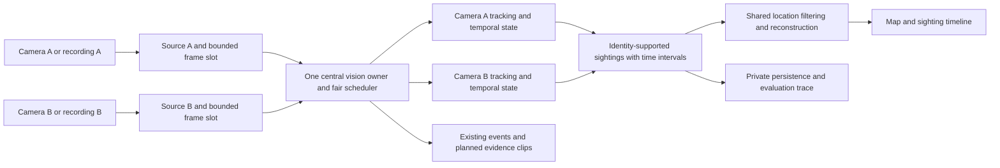

# Proposal: two-camera location estimation

Status: **undecided proposal; not approved for implementation or scheduled**, updated
11 November 2026. This document preserves an implementation-ready technical design
for discussion. It is separate from the accepted preliminary
[scope and Gantt chart](SCOPE_AND_SCHEDULE.md): no location tasks, resources or milestones
are allocated there.

If adopted, the intended sequence is two recordings first, then two live cameras,
with room/corridor-level possible areas. The discussed 4 January 2027 target for
both versions is conditional on selecting this proposal, not an existing delivery
commitment. The team's actual progress/final report deadlines remain 27 November
2026 and 4 January 2027. Detailed requirements below describe how the feature would
work if implemented; they are not evidence that it exists or a decision to build it.

## 1. Proposed scope and product contract

| Topic | Design assumption if adopted |
|---|---|
| Spatial output | Rooms, corridor sections and possible areas; no exact person coordinates |
| Processing order | Two recordings first, then two simultaneous live camera feeds |
| Conditional delivery target | Both versions by 4 January only if the team selects this proposal; no current schedule allocation |
| Available hardware | Three team laptops; two can supply webcams and one runs central inference/UI |
| Phone cameras | Optional interchangeable sources once the two-laptop route works; not a dependency |
| Camera placement | Fixed during a run, selected by the team in a small controlled space |
| View overlap | May overlap or be disjoint; overlap is not required for this design |
| Identity scope | Confirmed enrolled identities across cameras; unknown faces retain only local track identity |
| Single-camera zones/trails | Excluded: no image-polygon editor, pixel-path overlay or new single-camera movement feature |
| Geometry | Manual site/coverage configuration and route constraints; no stereo triangulation or floor-coordinate reconstruction |
| Capacity planning | Three-person dependency schedule; no weekly-hour estimate or holiday blackout is required by the user |

A person page/map must answer: **where were they observed, when, and which areas
remain possible under the declared model?** It must distinguish observations from
inference, and a causal estimate from a historical reconstruction using later sightings.
Theoretical CCTV/IP-camera use motivates the interface; the evaluated installation
uses team hardware, not an assumed existing CCTV network.

Physical room/corridor areas are still needed for the map. These are different from
excluded single-camera image zones: a camera maps to its entire configured coverage
area, not a polygon drawn around a face in the video. If one camera sees several
rooms/areas, a sighting initially supports their union; the system cannot select one
from image coordinates without adding a separate mapping method.

## 2. What the current code already supplies

The [pipeline](../backend/src/face_surveillance/classical/pipeline.py) already returns
face `bbox` coordinates, local `track_id`, identity state, scores, evidence age and
missing status. The [service](../backend/src/face_surveillance/classical/service.py)
draws boxes on the preview. Detection is not merely a face-present boolean.

Recognition is now injected; extraction/matching can be shared by camera pipelines.
The present operator service has one active source, uses host-receipt time for its
webcam, and derives replay time from frame index/FPS. Its persistent appearance events
are cooldown-suppressed and do not store a complete observation history. Therefore:

- Reuse detector/recognizer, per-camera tracking, temporal decisions, operator guards
  and existing gallery/event/privacy behavior.
- Add stable camera IDs, timestamp provenance, an identity-supported sighting stream,
  site configuration, map inference and a two-source coordinator.
- Do not derive location history from appearance events or replay execution time.
- Keep local track IDs scoped by camera/session; matching numeric IDs are not evidence
  of the same person across cameras.

## 3. Physical deployment and site setup

Use two fixed laptop webcams viewing selected patches/doorways or room areas, plus
the inference laptop on the same trusted local network. Use one small site, initially
roughly three to six named areas, with actual doors, corridor junctions and exits.
Record camera placement/view, source resolution/orientation, visible coverage and
connection layout during the site survey. A schematic drawn by the team suffices;
a surveyed architectural floor plan is not required.

The configuration contains:

| Entity | Required information |
|---|---|
| Area | Stable ID, name, room/corridor/outside type, schematic display shape or layout position |
| Route node | Portal, junction or small observation patch; associated physical area IDs |
| Route edge | Endpoints, allowed direction, conservative minimum traversal seconds, traversed area IDs and measurement/assumption note |
| Camera | Stable ID, name, source kind, coverage support on the route graph, displayed coverage areas and view/configuration version |
| Recording | Artifact ID/hash, camera ID, timestamp sidecar or declared media clock, clock mapping/error and source dimensions |
| Run | Site/configuration hash, source IDs, model/gallery/policy versions, timing assumptions, mode and completion/error status |

Edges describe permitted movement, not straight lines through walls. Add explicit
building/site exits leading to an `outside_or_unmapped` state; do not trap a person
inside the mapped site simply because another area was not drawn. An unavailable or
uncertain connection must be conservative, not silently treated as a locked door.

Minimum traversal time must be a plausible **lower bound**, not average walking time.
It can come from conservative route-length bounds divided by a declared maximum
speed, or a documented experimental assumption validated with fast traversals. Do
not infer a universal human-speed guarantee from a few pilot walks. A touching-area
boundary may have zero crossing cost. Represent actual travel across a long room or
corridor using entry/exit nodes and route edges; do not assign a positive delay just
because two room labels differ. Internal uncertainty is retained as graph support.

Coverage support may include nodes and portions/whole edges. It must include every
configured route position that the camera might observe. Never replace a broad field
of view with the camera's mounting point or the center of a room. If coverage cannot
be narrowed reliably, use the wider support and report the resulting larger estimates.
Schematic layout positions are for drawing, not person coordinates or distance units.

Validate unique IDs, all references, finite nonnegative edge costs, explicit edge
directions, valid coverage and exits, and source-to-camera assignment before starting.
Editing placement, connectivity, coverage or timing assumptions creates a new version
and starts a fresh run; previous predictions retain their original configuration.

## 4. A common observation contract

Each selected frame carries `camera_id`, `session_id`, `frame_seq`, local media time,
normalized run time, an observation-time interval and `timestamp_basis`. Frame time
is separate from decoding, inference, persistence and UI-display times.

A persisted identity sighting contains:

```text
sighting_id, run_id, camera_id, session_id, frame_seq, local_track_id,
time_lower_s, time_upper_s, timestamp_basis,
person_id, recognition_revision, model/gallery/policy references,
score, score_kind, evidence_count, coverage_support, site_config_hash
```

Use a finite monotonic time axis within each source and validate the mapping to the
run timeline. The interval is the earliest/latest plausible observation time, not a
probability distribution. Embeddings and original face crops are not needed in the
location engine. Confidence evidence remains attached to the sighting for review.

An identity sighting requires a current detected face, unambiguous local association,
a usable recognition observation agreeing with the current confirmed identity, and
fresh evidence. A predicted/missing box or old confirmation alone cannot anchor a
new location. Expose current-observation usability/support from the pipeline rather
than guessing it from the last decision. The existing `reason` field is insufficient
as the sole stable contract for this check.

Record identity observations independently of appearance-alert cooldown. Start with
at most one routine sighting per second per person/camera, plus immediate supported
identity/session changes; preserve timing intervals and gaps. This is a proposed
sampling setting to validate, not a rule that every camera frame must be saved.
Use the existing finite track limits. Unknown/candidate/insufficient observations
can appear in current previews, but do not establish cross-camera identity anchors.
Alert enablement and matching remain separate: disabling appearance alerts does not
by itself delete an enrolled identity or imply location tracking is disabled.

## 5. Time alignment: recorded version

Record each laptop's video together with a frame-index/timestamp sidecar where
possible. The sidecar uses monotonic host receipt times anchored to a checked shared
reference; these are not asserted to be sensor-exposure times. Validate decoded frame
counts/order against the sidecar and retain actual gaps, even when the video container
is encoded at constant FPS. Prefer the sidecar over fabricated uniform capture times.

Map each source clock into experiment-relative seconds:

```text
run_time = offset_s + drift_scale * local_time
observation_interval = [run_time - error_before_s, run_time + error_after_s]
```

Calibrate offsets with a reference visible to both cameras during setup, or a checked
common clock/procedure. Recheck at the end to bound drift; cameras can temporarily
share a setup view even if their final views do not overlap. Record the method and
error bound. Clock synchronization settings alone are not evidence of perfect timing.
If local media time is the only source, explicitly record the known start offset and
its uncertainty. Unbounded or missing alignment permits per-camera replay but disables
cross-camera time-constrained inference with `timing_unavailable`.

For two recordings, process each through the shared pipeline, then merge sightings
in normalized time order. Tie-breaking is deterministic, while overlapping time
intervals remain simultaneous/uncertain rather than being given a fabricated physical
order. Exhaustive offline processing does not drop selected frames. The replay cursor
uses recording time, not how quickly either inference pass ran. VFR phone footage
needs validated presentation timestamps or a conversion with a preserved time mapping;
it cannot silently use frame-index/FPS as if it were CFR.

## 6. Time alignment and transport: live version

Two capture laptops publish separate configured streams to the inference laptop.
Use standard RTSP publishing through a local MediaMTX gateway as the first integration
route; select tested publisher/decoder versions during the connectivity task. Network
addresses/credentials are local configuration, not arbitrary URLs accepted from a
browser. Keep the operator API on loopback. No phone app, custom video protocol,
cloud relay or public stream directory is required.

The source adapter must carry either verified sender timestamps or a declared
receiver-time interval that accounts for bounded transport/decoder age. The same
receiver clock simplifies alignment but does not eliminate different camera delays.
Prefer preserved sender timestamps when the complete publisher/gateway/decoder path
actually exposes them. MediaMTX can route absolute timestamps, but its documented
default replaces incoming ones; enabling preservation does not prove the clocks are
correct, and OpenCV frame receipt alone does not expose every transport timestamp.
This capability must be tested end to end, not assumed from protocol support.

A receiver-time fallback uses a measured/declared frame-age bound plus clock error.
Treat that bound as an evaluated assumption, show it in status, and disable tight
location exclusions when timing quality is unavailable or no longer applicable.
Do not substitute network ping time for measured capture-to-receiver delay.

Use a small bounded reorder window derived from the validated lateness bound. Publish
a causal estimate with its time/watermark and processing lag. A late sighting is
retained as late evidence and may revise labeled history; it must not silently
rewrite an already displayed causal result as if it had been known earlier.

## 7. Shared location algorithm

The same pure location engine consumes sightings in recorded and live modes. It
operates on graph support (nodes and in-transit edge portions) and returns named
possible areas. A set of room labels alone is insufficient internal state: different
positions in the same corridor can have different feasible next destinations.

### Causal filtering

With a supported sighting at time tA, propagate its possible support along permitted
routes, allowing waiting and reversals where allowed. For a later query t:

```text
possible_support(t) = Reach(previous_support, allowed_elapsed_time)
```

Use conservative interval bounds when observation times are uncertain. For example,
from a prior interval ending/starting at different times, the maximum elapsed time
uses its earliest plausible prior time and the latest query time. Retain those timing
bounds and model version in the result. Missing detections never subtract possible
areas: face detection can fail while someone is present.

When a new identity-supported observation arrives, intersect the propagated support
with that camera's coverage support. A nonempty intersection constrains the estimate;
do not reset to a needlessly wider camera footprint. Keep the accepted sighting
provenance. An empty intersection is a conflict, not permission to invent a route.

### Retrospective reconstruction

For accepted observations A and B and an intermediate time t:

```text
R(t) = ForwardReach(supportA, t - tA)
       intersect BackwardReach(supportB, tB - t)
```

This is a necessary-constraint, conservative possibility model, not a guarantee that
every remaining room was visited. Use interval-aware bounds, reverse directed edges
for backward queries, and combine the sequence of observations with forward filtering
and a backward constraint pass. Never intersect only room names and infer an exact
physical meeting point. Do not backfill future information into causal evaluation.

Include travelers partway along an edge. A node-only implementation would incorrectly
leave a person at a doorway until they reach the next node. For a directed edge u→v
with minimum traversal cost w, let q denote cost-distance from u. A forward/backward
query includes its feasible portion when these inequalities have a solution:

```text
0 <= q <= w
forward_distance_to_u + q <= available_time_from_A
(w - q) + backward_distance_from_v <= available_time_to_B
```

Handle each permitted direction and zero-cost edges explicitly. Report the union of
areas associated with feasible nodes/edge portions. These internal intervals are
route-model coordinates, not claimed measured person positions. For the small site,
standard-library adjacency lists, Dijkstra shortest paths and bounded support sets
are enough; no learned motion model, graph framework or GIS service is required.

### Worked example (illustrative assumptions)

Suppose route costs are A→junction = 4 seconds, junction→B = 6 seconds, and
junction→side-room = 4 seconds, with reverse travel allowed. A sees the person at
0 seconds and B at 14 seconds. At 9 seconds, forward reachability alone includes
the side-room node (8 seconds from A). But returning from that node to B needs at
least 10 seconds, while only five seconds remain. The later B sighting excludes it
from reconstructed history at that time. A portion of the main corridor remains
possible. These numbers illustrate the model; they are not measured site parameters.

## 8. Identity conflicts and uncertainty states

Cross-camera association uses the same enrolled person ID with compatible model/
gallery provenance. It does not compare track IDs or mix embeddings from different
spaces. Fusion may supply accepted identity evidence through the same observation
contract; the location engine does not average recognizer scores itself.

Use one canonical person-ID namespace across cameras and participating recognizers.
If model galleries are stored separately, enrollment must preserve that mapping;
equal display names or separately generated UUIDs are not identity equivalence.

| Situation | Required behavior |
|---|---|
| Several possible routes/areas | Return their union; never choose a convenient straight line |
| Simultaneous sightings in overlapping coverage | Accept the compatible spatial intersection; retain both observations |
| Incompatible simultaneous sightings or impossible transition | Mark `conflicted`, preserve evidence and alternatives; suspend a single authoritative estimate |
| Two distinct local tracks claim the same identity | Flag identity collision; no automatic track merge or silent choice |
| Candidate/unknown/insufficient recognition | No new enrolled-identity anchor; retain only the prior estimate with increasing age |
| Camera disconnect/stall | Mark that source unavailable; do not interpret it as observed absence |
| Clock invalidity/jump or unbounded network age | Mark `timing_unavailable`; avoid time-based exclusions until re-established |
| All mapped areas or an exit become reachable | Show `unlocalized` or `outside_possible`; retain last observed area/time |
| No valid initial sighting | Show `no_sighting`, not a person marker placed at a camera |
| Session/model/gallery/configuration change | New provenance/run or fresh evidence; never join incompatible histories silently |
| End of recorded replay | Label ended; stop the replay cursor rather than extrapolating using wall time |

Distinguish source health from location state. A system can have a healthy feed but
an unlocalized identity, or a failed camera and an explicitly aging inferred region.
Scores are not probabilities; reachable regions are not probability heatmaps.

## 9. Runtime architecture and integration



For live mode, maintain separate per-camera `Pipeline` state and capacity-one capture
slots, while sharing loaded detector/recognizer instances in one central vision owner.
Use fair scheduling (initially round-robin among ready sources) and report per-source
cadence, drops, frame age and queue delay. A busy feed must not starve another. Do not
load an independent model suite for every browser connection or camera.

Keep one API process and local persistence. Because two decoders may stall independently,
use supervised decode processes for the network sources and a separately supervised
vision process when integrating live mode; initialize CUDA inside its owner. Use
bounded local messages/preview slots and explicit stop/session generations. This is
a focused replacement of the current single-source execution boundary, not separate
microservices, a broker, distributed GPU workers or a multi-user platform.

Recognition, event recording and map rendering must not block the HTTP loop or hold
one shared lock for a whole recording. The API owns short database writes and validates
current gallery/run eligibility before accepting results. Stop/delete invalidates
pending work; acknowledgement completes after workers stop or apply the new state.
A failed decoder is restarted as a new source session, leaving the other source
available. A failed shared GPU worker marks both recognition paths unavailable and
clears identity evidence; existing last-sighting metadata is labeled historical.

Implementation reaches:

| Area | Planned change |
|---|---|
| Pipeline | Expose current-observation support and stable provenance alongside existing boxes/tracks |
| Source/service coordinator | Stable camera IDs, frame sequence/time intervals, two-source lifecycle and fair central inference |
| New spatial modules | Validated site/time models, sighting filtering, route propagation and reconstruction; create files as needed |
| Existing storage | Spatial runs and sightings with person foreign keys, version references, retention and deletion |
| Evaluation runner | Reuse recognition processing; emit/replay sighting traces, normalize clocks and compare location methods |
| API/UI | Site/run controls, per-camera previews/health, map and timeline with explicit uncertainty |
| Event clips/evidence panel | Retain camera/session identity and synchronize evidence to the same observation time |

Do not implement a second recognizer/gallery stack for spatial analysis. Recorded
inputs use the same algorithm contracts, while execution remains exhaustive rather
than using live-frame replacement. No single-camera polygon/trail feature is needed.

## 10. Persistence, API and user workflows

Site/source configuration is private, versioned JSON validated with Pydantic and
atomically activated. Source secrets stay outside report exports. Store sightings
and run metadata in the existing SQLite database with indexed person/run/time
references and cascade deletion. Persist no unknown cross-camera identities or new
face crops. Keep current previews and unknown local track state transient; authorized
experiment prediction traces remain separately managed study artifacts.

Apply the configured event-metadata retention to new operational sighting histories;
research recordings/results follow the declared study lifecycle. Add finite per-run
trace and disk budgets. If reliable persistence cannot proceed, mark the run incomplete
or pause spatial logging with an explicit reason; never grow an unlimited spool.
Deleting a participant removes linked sightings/events/clips and invalidates their
active map/history state and pending worker results. Exports/backups need separate
cleanup, as already documented. Do not claim SQLite metadata is encrypted merely
because descriptor payloads are encrypted.

Planned local routes (not implemented; retain existing Host/Origin/token guards):

| Route | Contract |
|---|---|
| `GET/PUT /api/site` | View/validate site, camera coverage, route assumptions and version; activation requires stopped/new sessions |
| `POST /api/spatial/recordings` | Stage bounded private video/time-sidecar uploads, returning artifact IDs without starting playback |
| `POST /api/spatial/runs` | Validate recorded/live manifest and start one bounded run job; reject incompatible active runs rather than queueing unlimited work |
| `GET /api/spatial/runs/{id}` | Mode, progress, clock quality, per-camera health/cadence, configuration and completion/error state |
| `POST /api/spatial/runs/{id}/stop` | Stop sources/workers with bounded cleanup and a visible interrupted result |
| `GET /api/spatial/runs/{id}/sightings` | Paginated observation timeline; explicitly tag late/conflicting evidence |
| `GET /api/spatial/runs/{id}/locations` | Bounded time query; separate causal and reconstructed possible-area results with supporting sighting references |
| `GET /api/spatial/runs/{id}/preview/{camera_id}` | Matching-frame preview/metadata, independent of map polling and never rerunning inference |

Recorded uploads are staged individually so two videos do not bypass the current
per-request limit. References use managed artifact IDs, not arbitrary browser-supplied
filesystem paths. Run creation is asynchronous with one admitted analysis/live job;
status/stop remain responsive. Return actionable invalid-input/conflict/overload errors.

The UI provides a small schematic map, two preview/status panels and a per-person
sighting timeline. Use distinct text/patterns for observed, inferred, reconstructed,
conflicted and unavailable states. Show last-seen age, timing basis/error, active map
version and movement assumptions. Highlight possible areas rather than animating an
exact dot through unseen space. Recorded mode has a shared time slider; reconstruction
is a separate view. A schematic point representing an area is labeled as an area
symbol, never a measured person position.

## 11. Verification and final evidence

Before evaluating people, hand-derived fixtures must cover directed/bidirectional
routes, waiting, alternatives, in-transit edges, zero-cost edges, exits, broad coverage,
multiple sightings, conflict, interval times and deterministic ordering. Replaying
the same valid trace must reproduce the same outputs. Causal output at time t cannot
change merely because a future sighting is appended; reconstructed history may change.

Integration tests cover two recording sidecars, count mismatch, offset/drift, missing
timing, repeated timestamps/gaps, identity reset, delayed live messages, source failure,
restart, gallery deletion during work, privacy cleanup, quotas and bounded queues.
Live tests additionally cover delayed/dropped frames, clock jumps, one-source stall,
shared-worker failure, fair per-camera service and event-clip overhead. Test CPU and
required-GPU profiles explicitly where hardware permits; do not silently switch modes.

Record controlled walks on the configured site, with independently checked person,
area and time labels, including side-room detours, waits, reversals, departure from
the map, unknown people, overlapping sightings and deliberate misses. Use development/
validation walks to choose assumptions; freeze the map/configuration before held-out
walks. Do not tune travel bounds on the final paths. Evaluate with ground-truth sighting
identities first to isolate spatial logic, then with actual recognizer outputs to
measure propagated identity errors.

Compare last-seen-only, forward reachability and retrospective reconstruction:

- Ground-truth area inclusion, reporting conflict/unavailable/unlocalized cases too.
- Predicted set size (number of areas; physical area only when actually surveyed).
- Incorrect identity associations, missed transitions and false feasible/impossible links.
- Observation age and time until a new sighting reduces uncertainty.
- Sensitivity to movement/coverage assumptions, timing errors and missed observations.
- Per-camera input/processed cadence, drops/age, location latency and resource use for
  one versus two feeds, with individual versus ensemble runtime identified.

An entire-building prediction has high inclusion but low usefulness. Report inclusion
and set size together; don't advertise "pretty accurate" from inclusion alone.
Separate live causal results, recorded causal results and retrospective results.
Keep unique recording exposure, commands, input/configuration hashes, clock calibration
and completed/interrupted status. Final delivery includes a reproducible two-recording
run, a two-live-camera demonstration, map/timeline screenshots, comparison figures,
reported failure cases and the setup/limitations section of the report.

## 12. Implementation sequence and acceptance gates

| Step | Planned outcome | Exit evidence |
|---|---|---|
| L1 | Site survey, camera/source/time schema and two-laptop publishing/clock feasibility | Recorded camera coverage and route assumptions; checked timestamp/latency provenance |
| L2 | Identity-supported sighting export and aligned two-recording replay | Deterministic merged trace, known offsets and explicit invalid-clock handling |
| L3 | Shared room-level forward/reconstructed location engine and map/timeline UI | Hand-derived tests including edge transit/conflicts; observed versus inferred distinction |
| L4 | Two-live-source coordinator, shared models, bounded scheduling and recovery | Both sources update the map without starvation; measured timing quality, stop/restart and failure evidence |
| L5 | Held-out recorded/live walks, performance, failure analysis and reproducible demo | Metrics and deliverables in section 11; claims limited to measured site/hardware |

These five steps are an unscheduled implementation sequence if the proposal is
selected. L1–L3 precede the integrated live version in L4; final evaluation requires
frozen site/method and timing assumptions. They are not tasks in the current Gantt.
Existing completed milestones remain historical, and neither report is required to
claim completion of this proposal. Physical site IDs, placements, edge costs and
measured timing bounds would be filled in during L1. Placeholder values may support
unit fixtures, not a claimed real-site estimate. Dates/resources would be assigned
only after the team decides whether to implement location estimation.

## References and technical boundaries

The location model above is this project's proposed design. Stereo triangulation and
homography solve different geometric problems and are not required for camera-to-area
association: [OpenCV camera geometry](https://docs.opencv.org/4.x/d9/d0c/group__calib3d.html),
[OpenCV homography](https://docs.opencv.org/4.x/d9/dab/tutorial_homography.html).
Across-camera association is a separate task from within-camera tracking; see
[Tesfaye et al., 2017](https://arxiv.org/abs/1706.06196).

MediaMTX documents [webcam publishing](https://mediamtx.org/docs/publish/generic-webcams),
[publish/read protocols](https://mediamtx.org/docs/features/publish-and-read),
[absolute timestamp handling](https://mediamtx.org/docs/features/absolute-timestamps)
and [authentication](https://mediamtx.org/docs/features/authentication). These establish
available transport features, not a tested configuration for this project's laptops.
Pin actual versions and verify decoder/timestamp behavior during L1/L4 rather than
copying untested commands into a performance claim.

If the proposal is selected, its live acceptance run must provide checked timing and produce
location estimates. Displaying only `timing_unavailable` demonstrates a failure path,
not completion of the live-location requirement. L1 proposes and L4 freezes the
hardware-specific input profile (resolution/FPS, faces, gallery and active models)
and cadence/latency/frame-age targets before held-out live walks; report failures
against that profile rather than inventing a universal performance guarantee.
