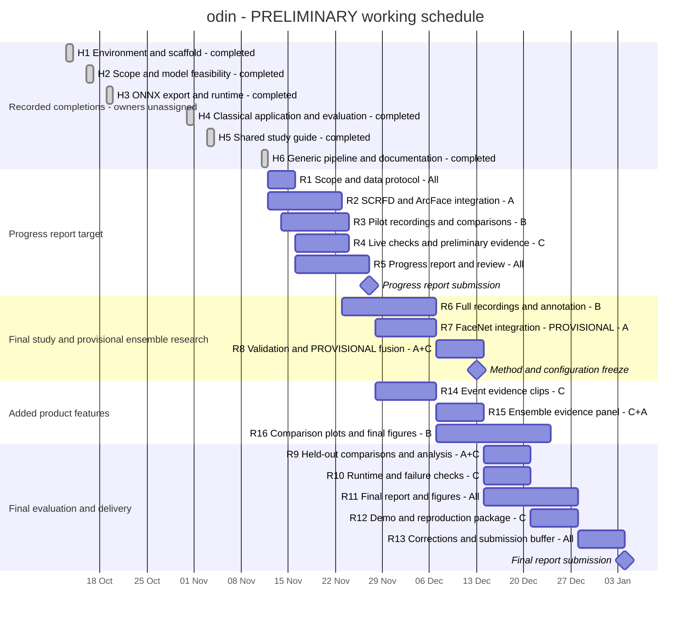

# odin: preliminary scope and schedule

Prepared 11 November 2026 for a three-person team. User-supplied milestones:
**progress report: 27 November 2026; final report: 4 January 2027**. There are
approximately eight weeks remaining. Earlier dates in supplied/historical documents
do not override these updates. The user reports no major unavailable dates and
requests dependency-based planning without weekly-hour estimates. Submission times
were not supplied.

Status: **preliminary working plan**, accepted as a starting point for refinement.
Dates below are planned, not claims of actual work. Roles A/B/C are provisional
work leads, not verified individual contributions. The report directory is unchanged.
The editable chart below follows this plan; update both when dates or scope change.

## Delivery scope

### Progress-report target

Use the implemented classical application as the starting point. Add SCRFD detection
and an ArcFace recognizer behind the existing detector/recognizer boundary, demonstrate
enrollment and replay with the neural path, and collect a small authorized pilot.
Compare LBP and ArcFace on pilot inputs if the recordings and integration are ready;
otherwise describe integration/data collection honestly as ongoing. Full final-test
evaluation is not a prerequisite for the progress report.

The report should present the problem, actual completed implementation, model
preparation evidence, available pilot results, current challenges, this remaining
schedule, actual contributions and GenAI disclosure. Its Gantt chart requires named
owners, dates and task status/progress; do not invent missing historical assignments.

### Final-report core

- Complete an independent recording/annotation study covering known and unknown
  people, pose, lighting, face size/distance, physical masks/occlusion, crossings,
  reappearance, alert-disabled identities and empty scenes.
- Validate LBP and ArcFace under the same identity/session protocol, with separate
  compatible galleries, score semantics and validation-selected thresholds.
- Use shared SCRFD detections where practical for a matched-observation recognition
  comparison. Report the existing Haar/LBP complete pipeline separately so detector
  differences are not mistaken for recognition gains.
- Measure correct/wrong/rejected/unresolved outcomes by condition, event correctness,
  misses/duplicates/delay, and live processing/drop/frame-age behavior on named hardware.
  A small single-observation versus temporal comparison can use existing policy settings.
- Verify live operation, source failures, deletion and a sustained run. Fix measured
  failures rather than scheduling a general rewrite of working components.
- Deliver reproducible configurations/results, final analysis/report and a demo package.

### Added final-product requirements

These three features are planned final-product requirements in the preliminary
scope, not already implemented or required by 27 November. Location estimation is
an undecided, unscheduled proposal and is not part of these requirements.

| Feature | Smallest complete version | Acceptance evidence |
|---|---|---|
| Ensemble evidence panel | Show each executed method's candidate-specific raw score, score meaning, threshold and acceptance; show disagreement and the combined decision/rule when fusion is available. Label methods not run or unavailable. Reuse saved inference results rather than running models from UI polling. | Inspect an agreeing case, disagreement, unknown rejection and unavailable-method case; displayed evidence matches recorded results |
| Recognition comparison plots | Export individual/fused comparisons, per-condition outcomes, threshold tradeoffs and event delay alongside misses, with denominators and processing cost | Figures can be regenerated from identified runs; validation threshold plots stay separate from frozen-test results |
| Event evidence clips | Retain a short bounded interval around a confirmed eligible appearance, starting with a proposed five-second pre-roll and five-second post-roll. Record timestamps/cadence and gaps; expose pending/ready/failed evidence without delaying the durable event | Replay a saved clip; verify bounded memory/disk, retention and identity-linked deletion, including recording failure and incomplete footage |

Event clips add authorized contextual video storage to the existing descriptor-only
baseline. They do not authorize continuous permanent recording. Use the existing
configurable event-retention lifecycle, explicit disk/buffer bounds and private
storage. The selected interval and recorded cadence must be stated; dropped frames
cannot be presented as a complete full-rate recording. First implement fixed short
clips rather than an unbounded encounter recorder.

Single-camera image zones and trails are explicitly excluded at the user's request.
The separate [location-estimation proposal](LOCATION_ESTIMATION_PROPOSAL.md) retains
its detailed recorded/live design for discussion. The team has not decided to implement
it: it has no scope commitment, assigned resources, implementation dates or Gantt bars.

### Provisional final-stage target: FaceNet and ensemble research

The user envisions combining recognition methods for the final project; exact fusion
design remains open. Schedule this as a provisional research workstream, without
promising a better result or making preliminary progress-report claims about it:

1. Integrate FaceNet with its own preparation, gallery and threshold; establish its
   standalone baseline on the same protocol.
2. Expose scores for the same candidate identities from each recognizer. The current
   winner-only matching result is sufficient for individual recognition, not fusion.
3. Fit a small score-combination method using development recordings and select its
   acceptance policy on separate validation recordings. LBP distance and neural
   similarity must retain their distinct meanings; do not average unrelated raw
   winners or assume all three methods help.
4. Compare frozen individual methods and fusion on held-out recordings, including
   unknown acceptance, coverage, delay and processing cost. A negative fusion result
   is a valid research outcome. Include a fused live mode only if results and the
   runtime budget justify it.

The 13 December gate freezes the recognition methods and configuration entering final
testing. If fusion is not ready
or supported, report that status/negative evidence and preserve the working individual
baselines and required evaluation. Discuss any scope change explicitly with the team;
do not quietly substitute a staged demonstration for the planned experiment.

### Outside this schedule

Location estimation and its recorded/live multi-camera implementation remain undecided
and unscheduled. Single-camera image zones/trails, calibrated 3D triangulation, exact
floor coordinates, model training/fine-tuning, remote accounts, external notifications
and a new UI framework are excluded. No dedicated phone capture app is planned.

Quality-weighted temporal aggregation, a replacement local tracker and process isolation
remain possible responses to measured failures, not unconditional additional deliverables.
The detailed location proposal does not authorize adding those components to the current
implementation backlog.

## Completed work: historical Gantt rows

These belong in earlier chart weeks, not in the future implementation backlog.
Commit dates establish recorded completion, not true start dates or student authorship.
The preliminary chart shows one-day completion markers at repository evidence dates,
not invented historical task durations. Their table placement identifies the relevant
week. Actual start/end dates and owners still need team records.

| ID | Completed work | Repository evidence | Chart placement |
|---|---|---|---|
| H1 | Backend/frontend environment and scaffold | `44c8f1d`, 13 October | 12–18 October |
| H2 | Initial scope/architecture and pretrained-model CUDA feasibility | `92a1354`, `f085447`, 16 October | 12–18 October |
| H3 | FaceNet ONNX export, shared runtime and CPU readiness | `f996f58`, `bfae8a9`, 19 October | 19–25 October |
| H4 | Classical detector/recognizer, webcam/replay, gallery, tracking, temporal decisions, events, UI, privacy and evaluation runner | `b50f3d5`, `5ffa466`, 31 October | 26 October–1 November |
| H5 | Shared study guide and historical review archive | `f77add8`, 3 November | 2–8 November |
| H6 | Documentation consolidation and recognizer-independent pipeline boundary | `b6a6336`, `c2da51a`, 11 November | 9–15 November |

These implementation milestones are complete; their real-world validation is a
separate remaining task. FaceNet model execution/export is complete, while its
application recognizer and comparative study are not.

## Proposed team split

| Lead | Main work | Shared/review work |
|---|---|---|
| A: recognition | SCRFD/ArcFace integration, FaceNet if retained, calibration and fusion experiments | Explain methodology; review runtime/evaluation results |
| B: data | Actor-media sourcing/provenance, recordings/annotations, split manifests and comparison plots | All three help collect/review material; A/C review annotations |
| C: integration/evaluation | Live checks, event clips, evidence panel, reproducibility and demo packaging | Review integrations; coordinate assembling reports |

All three write/review their own technical report sections and agree on conclusions.
Map roles to actual names before the chart is submitted. Historical owners must come
from actual contributions, not this proposed future division.

## Proposed dates and dependencies

| ID | Task and reviewable outcome | Planned dates | Lead | Depends on |
|---|---|---|---|---|
| R1 | Agree scope, pilot protocol, partition rules, owners and chart | 12–15 November | A+B+C | H6 |
| R2 | SCRFD adapter and ArcFace enrollment/replay through shared pipeline | 12–22 November | A; C reviews | H3, H6 |
| R3 | Pilot capture/annotation; known/unknown examples and preliminary LBP/ArcFace checks | 14–23 November | B; A+C assist | R1; neural comparisons need R2 |
| R4 | Live webcam/runtime check and retained preliminary engineering evidence | 16–23 November | C | H4, H6; repeat neural checks after R2 |
| R5 | Write/review progress report, actual contributions, references, disclosure and Gantt | 16–26 November | All; C assembles | H1–H6; include available R2–R4 results |
| M1 | Submit progress report | 27 November | All | R5 |
| R6 | Full study capture, annotations, split manifests and annotation review | 23 November–6 December | B; A+C assist | R1, pilot lessons from R3 |
| R7 | Provisional FaceNet application integration and standalone checks | 28 November–6 December | A; C reviews | R2, H3 |
| R8 | Individual validation; provisional fusion implementation/development fit; threshold selection and configuration freeze | 7–13 December | A+C; B reviews data | R2, R6; fusion also needs R7 |
| M2 | Freeze methods/configuration and confirm final experiment scope | 13 December | All | R8 |
| R9 | Held-out individual/fusion comparisons, condition/event results and failure analysis | 14–20 December | A+C; B checks labels | M2 |
| R10 | Live performance/endurance and failure exercises, including clips/panel overhead; targeted fixes and affected reruns | 14–20 December | C; A assists | M2, R14/R15; material recognition changes reopen validation |
| R11 | Final results, discussion, figures and report drafting/review | 14–27 December | All | R9/R10/R16 results arrive during drafting |
| R12 | Reproduction instructions and demo/package verification | 21–27 December | C; A+B review | R9, R10 |
| R13 | Corrections, reproduction buffer, PDF checks and final submission preparation | 28 December–3 January | All | R11, R12 |
| R14 | Bounded event clips, evidence status, playback, retention and deletion checks | 28 November–6 December | C | R4; uses existing events/storage |
| R15 | Ensemble evidence panel using recorded candidate-specific results | 7–13 December | C; A supplies scores | R7/R8 score outputs; preserve unavailable states |
| R16 | Reproducible recognition comparison plots; final figures from frozen results | 7–23 December | B; A+C review | R6/R8 for plot preparation; R9/R10 for final data |
| M3 | Submit final report | 4 January 2027 | All | R13 |

Preparation/writing can overlap experiments, but final conclusions depend on actual
results. The buffer is for correction/delivery, not a new feature phase. The user
has confirmed no major unavailable dates; exact weekly hours are not a planning gate.
A owns recognition/fusion, B leads the study and plots, and C leads integration and
product features, with shared testing/report work. These are provisional role
assignments, not claims of student contributions or guaranteed completion dates.

## Data and experiment limits to agree at the pilot

The study includes our own recordings of team members and consenting friends,
public-person media (especially actors), and public research datasets. Controlled
participant testing remains included for recognition, tracking, alerts and live
operation; actor media adds appearance-change comparisons. ChokePoint and ROF are
documented for later in [dataset planning](DATASETS.md). Start with a small actor
pilot; expand with separate unknown identities and enough independent appearances
before freezing the experiment. A possible target is 4–6 enrolled actors and four
unknown actors, two for development/validation and two held out for final test.
This is not a completed dataset or sufficient evidence for population claims.
Known identities need separate reference/development/validation/test films or sessions
if fitting fusion; unknown final-test identities must stay outside all fitting and
selection. If collection cannot support that separation, simplify the experiment and
disclose the limitation instead of reusing test data for tuning.

Cover each required condition without recording every possible combination.
Annotate a declared subset of frames plus encounter windows; absent annotations are
not negative labels. Keep unique recordings and all method configurations identifiable.
Actual identity/session counts and named owners remain team inputs. Spatial walks
and location-estimation experiments are not included unless that proposal is selected.

## Chart conventions

Use calendar weeks Monday–Sunday from 12 October, with the 4 January deadline shown
explicitly. Keep H1–H6 as completed historical rows; show R1–R16 as planned rows,
marking work ongoing/completed only from actual progress at report submission. M1/M2/M3 are milestones.
Use a distinct provisional style for FaceNet/fusion until the team settles that scope.
Task duration, working hours and completion percentage are different quantities.
The chart must not mark planned work complete merely because its scheduled date passed.

## Preliminary Gantt chart

This Mermaid source is editable and can be rendered by a Mermaid-capable Markdown
viewer. The task table above owns the outcomes/dependencies; bars show the proposed
calendar, including parallel work. A = recognition, B = data, C = integration/evaluation;
all three share recording/review/report work. These labels are not final name assignments.
Completed rows mark recorded completion dates only. FaceNet/fusion remains explicitly
provisional; future bars are planned, not claims of work already completed.

